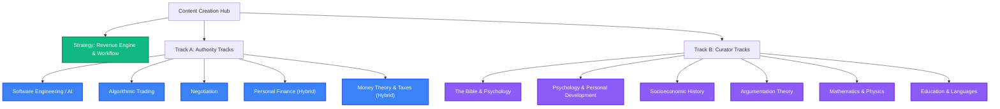

# 🔮 Content Creation Strategy & Brainstorming Hub

Welcome to the master repository for brainstorming, planning, and organizing content creation pipelines across different topics. 

We use a **universal content engine** that separates topics into two distinct tracks based on expertise: **Authority (Expert-led)** and **Curator (Learner/Synthesizer-led)**.

---

## 🗺️ Workspace Roadmap

For a detailed breakdown of the monetization funnel and the content creation loop, see [workflow-and-revenue-engine.md](workflow-and-revenue-engine.md). For a deep dive into the financial potential and conversion benchmarks of each channel, check out [channel-revenue-analysis.md](channel-revenue-analysis.md).

---

## 📁 Topic Directory & Strategic Tracks

Below is the mapping of our topics, their strategic tracks, and their designated folder structure.

| Topic Folder | Track | Focus & Positioning | Monetization Engine |
| :--- | :--- | :--- | :--- |
| 📁 **[software-engineering](software-engineering/README.md)** | **Authority** | AI-Native SDLC, SaaS architectures, domain design. | Ebooks, Premium courses, templates/boilerplates, corporate workshops. |
| 📁 **[└ agentic-ai-hub](software-engineering/agentic-ai-hub/README.md)** | **Curator** | Foundational AI theories, NLP history, Transformers, Multi-Agent systems, CrewAI. | Ebooks, newsletters, blog ads, podcast sponsorships. |
| 📁 **[algorithmic-trading](algorithmic-trading/README.md)** | **Authority** | Quantitative trading systems, backtesting setups, Python scripts. | Starter-kits, algorithm templates, technical ebooks, premium courses. |
| 📁 **[negotiation](negotiation/README.md)** | **Authority** | Tactical negotiation frameworks, corporate dispute resolution. | Corporate workshops, video templates, premium cohorts. |
| 📁 **[personal-finance](personal-finance/README.md)** | **Hybrid** | Wealth accumulation, saving systems, index investing models. | Curated newsletters, spreadsheets/calculators, ebooks, sponsor spots. |
| 📁 **[money-theory-and-taxes](money-theory-and-taxes/README.md)** | **Hybrid** | Macro monetary systems, central banking, fiscal policy, tax architecture. | Ebooks, tax strategy templates, video courses, macro briefings. |
| 📁 **[bible-psychology](bible-psychology/README.md)** | **Curator** | Biblical narratives analyzed through Jungian/evolutionary psychology. | Curated reading lists, visual posters/maps (POD merch), ebooks. |
| 📁 **[psychology-and-development](psychology-and-development/README.md)** | **Curator** | Cognitive biases, relationship mechanics, personal habits. | Synthesized books/summaries, journaling guides, accountability cohorts. |
| 📁 **[socioeconomic-history](socioeconomic-history/README.md)** | **Curator** | The rise of systems, historical economic shifts, geopolitics. | High-quality podcasts, display ads, sponsored newsletters, history merch. |
| 📁 **[argumentation-theory](argumentation-theory/README.md)** | **Curator** | Rhetoric, logical fallacies, structures of debate, critical thinking. | Cheat sheets, debate cards, ebooks, curated reading guides. |
| 📁 **[mathematics-and-physics](mathematics-and-physics/README.md)** | **Curator** | Core theories, history of science, beautiful equations. | Visual equation posters/t-shirts (POD), explanatory blog posts. |
| 📁 **[education-and-languages](education-and-languages/README.md)** | **Curator** | Language learning frameworks, memory systems, pedagogy. | Curated vocabulary cards, learning Notion templates, study plans. |

---

## 🚀 How to Add a New Topic

When kicking off a new topic:
1. Create a folder using the directory structure outlined in [workflow-and-revenue-engine.md](workflow-and-revenue-engine.md#-topic-setup-template).
2. Write a `README.md` at the root of that folder outlining:
   - The specific persona you will use (Authority vs. Curator).
   - The value ladder products you want to target (e.g., Ebook titles, newsletter themes, merch designs).
   - Core research resources and a backlog of content ideas.
