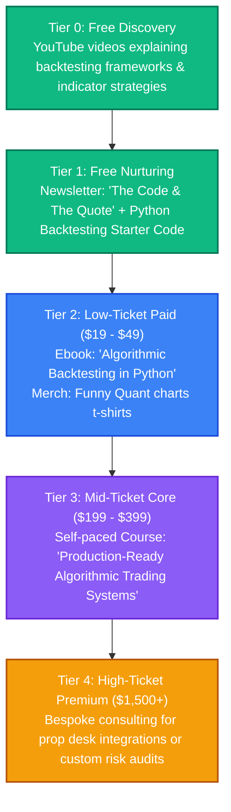

# Algorithmic Trading: Strategy & Content Pipeline

This directory is dedicated to brainstorming, drafting, and organizing content related to quantitative and algorithmic trading.

---

## 👥 Persona & Track Positioning
*   **Track**: **Track A (Authority)**
*   **Persona**: Technical Quantitative Trader.
*   **Narrative**: *"How to automate your market edge using structured, backtested Python code and systematic risk management."*
*   **Target Audience**: Developers, data scientists, and finance enthusiasts looking to move from manual trading to systematic algorithmic execution.

---

## 📈 The Algorithmic Trading Value Ladder



---

## 📂 Folder Structure Setup

```text
📁 algorithmic-trading/
├── 📄 README.md                 # This overview
├── 📁 blog/                     # SEO-optimized Python backtesting tutorials
├── 📁 podcast/                  # Transcripts of talks on quantitative theories
├── 📁 courses/                  # Outline files for Udemy & Self-hosted platforms
├── 📁 books/                    # Draft chapters for quantitative ebooks
├── 📁 assets/                   # Charts, diagrams, and print-on-demand designs
└── 📁 templates-and-code/       # Python code packages, backtesting frameworks, indicators
```

---

## 💡 Raw Brain Dumps & Topic Ideas
*   *Idea 1*: "Building your first backtester in Python using pandas: A step-by-step guide."
*   *Idea 2*: "Why 90% of backtests lie: Look-ahead bias, survivorship bias, and overfitting."
*   *Idea 3*: "Leveraging Vectorized vs. Event-Driven execution models in trading code."
*   *Idea 4*: "Interfacing Python algorithms with Interactive Brokers API (IBKR) / MetaTrader."
