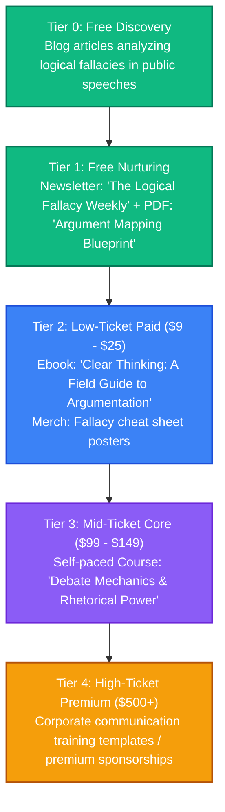

# Argumentation Theory: Strategy & Content Pipeline

This directory is dedicated to brainstorming, drafting, and organizing content related to formal debate, rhetoric, critical thinking, and cognitive defense against logical fallacies.

---

## 👥 Persona & Track Positioning
*   **Track**: **Track B (Curator)**
*   **Persona**: Logical Architect & Rhetoric Analyst.
*   **Narrative**: *"How to think clearly, argue constructively, and protect your mind from propaganda and cognitive manipulation."*
*   **Target Audience**: Students, professionals, writers, and anyone looking to improve their debate skills, conversational structures, and critical analysis.

---

## 📈 The Argumentation Theory Value Ladder



---

## 📂 Folder Structure Setup

```text
📁 argumentation-theory/
├── 📄 README.md                 # This overview
├── 📁 blog/                     # Fallacy breakdowns and rhetoric case studies
├── 📁 podcast/                  # Transcripts of debates analyses and breakdowns
├── 📁 courses/                  # Outline files for communication and debate modules
├── 📁 books/                    # Draft chapters for argumentation ebooks
├── 📁 assets/                   # Logical maps, fallacy flashcard designs
└── 📁 templates-and-code/       # Argumentation outline templates (Notion/Markdown)
```

---

## 💡 Raw Brain Dumps & Topic Ideas
*   *Idea 1*: "The Strawman vs. the Steelman: How to argue against the strongest version of your opponent's claim."
*   *Idea 2*: "How to spot Gaslighting and Ad Hominem attacks in real-time."
*   *Idea 3*: "The Toulmin Model of Argumentation: Claims, warrants, backing, and qualifiers."
*   *Idea 4*: "Cognitive biases in debate: How confirmation bias halts productive conversations."
