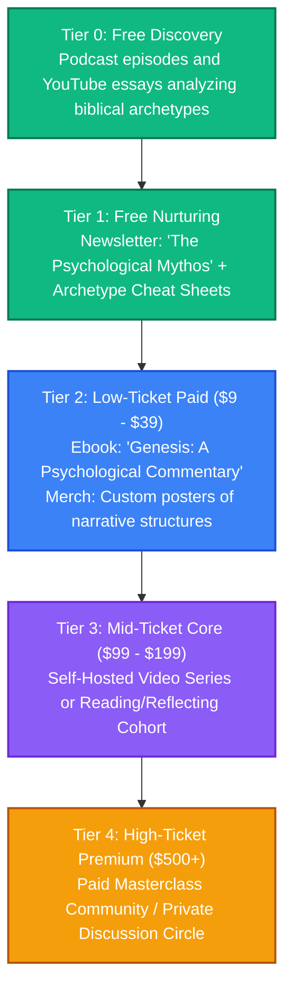

# The Bible & Psychology: Strategy & Content Pipeline

This directory is dedicated to brainstorming, drafting, and organizing content related to the psychological meaning, literary structures, and evolutionary archetypes found within biblical literature.

---

## 👥 Persona & Track Positioning
*   **Track**: **Track B (Curator)**
*   **Persona**: Analytical Mythologist & Synthesis Guide.
*   **Narrative**: *"Exploring ancient biblical stories not as dogma, but as deep psychological maps detailing the evolution of human consciousness and behavior."*
*   **Target Audience**: Intellectual explorers, psychology students, and individuals looking for secular or philosophical meaning in historical religious texts.

---

## 📈 The Bible & Psychology Value Ladder



---

## 📂 Folder Structure Setup

```text
📁 bible-psychology/
├── 📄 README.md                 # This overview
├── 📁 blog/                     # Detailed essays on narrative analysis
├── 📁 podcast/                  # Transcripts of podcast analyses and interviews
├── 📁 courses/                  # Outline files for structured video guides
├── 📁 books/                    # Draft chapters for psychological commentaries
├── 📁 assets/                   # Architectural narrative maps, merch graphics
└── 📁 templates-and-code/       # Notion templates for structural myth analysis
```

---

## 💡 Raw Brain Dumps & Topic Ideas
*   *Idea 1*: "Cain and Abel: The psychological roots of resentment and ideological possession."
*   *Idea 2*: "The Tower of Babel: Inflation, technological hubris, and the fragmentation of shared meaning."
*   *Idea 3*: "The Wilderness Wandering: How voluntary suffering precedes psychological integration."
*   *Idea 4*: "Abrahamic Sacrifice: The necessity of giving up what you love most to move forward."
