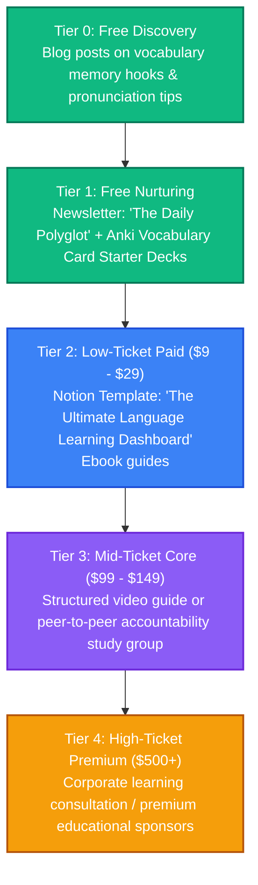

# Education & Languages: Strategy & Content Pipeline

This directory is dedicated to brainstorming, drafting, and organizing content related to vocabulary learning systems, language study guides, and cognitive pedagogy.

---

## 👥 Persona & Track Positioning
*   **Track**: **Track B (Curator)**
*   **Persona**: Meta-Learner & Language Facilitator.
*   **Narrative**: *"How to hack your brain's memory systems to learn languages and complex concepts in half the time."*
*   **Target Audience**: Students, professionals relocators, language hobbyists, and lifelong learners.

---

## 📈 The Education & Languages Value Ladder



---

## 📂 Folder Structure Setup

```text
📁 education-and-languages/
├── 📄 README.md                 # This overview
├── 📁 blog/                     # Pedagogical essays and study guide articles
├── 📁 podcast/                  # Transcripts of learning methods breakdowns
├── 📁 courses/                  # Outline files for meta-learning courses
├── 📁 books/                    # Draft chapters for language acquisition ebooks
├── 📁 assets/                   # Spaced repetition diagrams, learning infographics
└── 📁 templates-and-code/       # Notion vocabulary databases, Anki deck configuration files
```

---

## 💡 Raw Brain Dumps & Topic Ideas
*   *Idea 1*: "Spaced Repetition Systems (SRS): Why cramming doesn't work, and how to schedule your memory."
*   *Idea 2*: "The Input Hypothesis: Why consuming comprehensible content is the fastest way to speak a language."
*   *Idea 3*: "Building a memory palace: How to remember 50 foreign vocabulary words in one sitting."
*   *Idea 4*: "The 80/20 Rule of Language: The 600 words that make up 80% of daily conversations."
