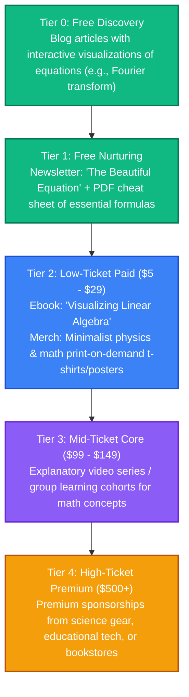

# Mathematics & Physics: Strategy & Content Pipeline

This directory is dedicated to brainstorming, drafting, and organizing content explaining complex mathematical concepts, fundamental physics theories, and the history of science.

---

## 👥 Persona & Track Positioning
*   **Track**: **Track B (Curator)**
*   **Persona**: Scientific Explainer & Mathematics Visualizer.
*   **Narrative**: *"Deconstructing the equations and physical laws that govern the universe into beautiful, intuitive, and accessible explanations."*
*   **Target Audience**: Science enthusiasts, students, software engineers (wanting to brush up on math), and curious minds.

---

## 📈 The Mathematics & Physics Value Ladder



---

## 📂 Folder Structure Setup

```text
📁 mathematics-and-physics/
├── 📄 README.md                 # This overview
├── 📁 blog/                     # Explanatory articles with equations (LaTeX)
├── 📁 podcast/                  # Transcripts of talks on the history of physics and scientists
├── 📁 courses/                  # Outline files for mathematical deep-dives
├── 📁 books/                    # Draft chapters for mathematical books
├── 📁 assets/                   # Vector plots, equation diagrams, t-shirt vectors
└── 📁 templates-and-code/       # Jupyter notebooks with simulations (Manim, NumPy)
```

---

## 💡 Raw Brain Dumps & Topic Ideas
*   *Idea 1*: "The Fourier Transform: An intuitive, visual explanation of how we decompose waves."
*   *Idea 2*: "Maxwell's Equations: How four simple lines of calculus describe all of light and electricity."
*   *Idea 3*: "Intuitive Linear Algebra: Why matrix multiplication is just stretching space."
*   *Idea 4*: "The Double-Slit Experiment: Deconstructing the boundary between particle and wave."
