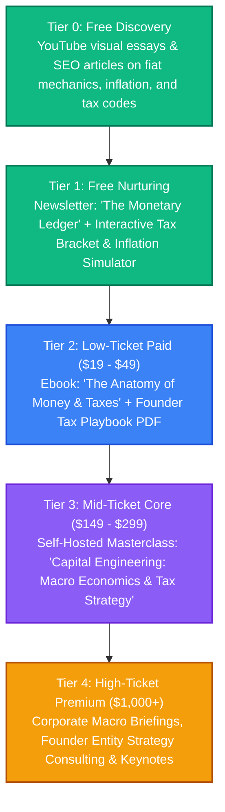

# Money Theory and Taxes: Strategy & Content Pipeline

This directory is dedicated to brainstorming, researching, drafting, and organizing content around the nature and mechanics of money, monetary policy, central banking, macroeconomics, fiscal policy, and strategic tax theory/architecture.

---

## 👥 Persona & Track Positioning

* **Track**: **Track A/B (Hybrid)**
* **Persona**: The Macro & Tax Architect / Monetary Realist.
* **Narrative**: *"Money is an engineered social technology, and tax codes are incentive blueprints written by states. Once you understand how money is created and how fiscal rules steer capital, you stop being a passive spectator and learn how to allocate, optimize, and protect your wealth."*
* **Target Audience**: 
  - Founders, software engineers, and high earners looking beyond basic budgeting toward structural understanding.
  - Independent investors, macro thinkers, and entrepreneurs who want first-principles clarity on monetary systems and legal tax minimization.

---

## 📈 The Money Theory & Taxes Value Ladder



### Tier Breakdown
* **Tier 0 (Free Discovery)**:
  * High-retention video essays: "How Money is Actually Created (It's Not How You Think)", "The Cantillon Effect: Who Gets the New Money First?", "Why the Super-Rich Borrow Instead of Selling".
  * Deep-dive SEO blog articles comparing Austrian economics, Keynesianism, and Modern Monetary Theory (MMT).
* **Tier 1 (Free Nurturing / MoFu)**:
  * Weekly newsletter breaking down central bank rate decisions, fiscal deficits, and upcoming tax law changes.
  * Lead Magnet: *The First-Principles Tax Architecture Checklist* + *Interactive Tax Bracket Calculator (Notion/Spreadsheet)*.
* **Tier 2 (Low-Ticket Paid / Entry-Level)**:
  * *Ebook*: "Money, Debt, and the State: A First-Principles Guide to Fiat, Inflation, and Tax Structures" ($19–$29).
  * *Digital Tool*: Notion Tax Planning System & Corporate Entity Comparison Matrix ($39).
* **Tier 3 (Mid-Ticket Core)**:
  * Comprehensive video masterclass covering:
    - Monetary history and the evolution of credit.
    - Central banking plumbing (Repo markets, reserves, QE/QT).
    - Strategic tax planning: Pass-through entities, capital gains vs. ordinary income, depreciation, and international tax fundamentals.
* **Tier 4 (High-Ticket Premium)**:
  * Bespoke advisory workshops for startup founders and tech leaders on corporate entity structuring and macro risk management.

---

## 🏛️ Core Content Pillars

### 1. The Mechanics of Money & Banking (Curator / Explainer)
* How fiat currency, commercial bank money (fractional reserve), and central bank reserves actually operate.
* The difference between money, currency, and credit.
* Competing schools of thought: Austrian vs. Keynesian vs. Modern Monetary Theory (MMT) vs. Monetarism.
* The history of money: From ledger debt and commodity currency to the gold standard and Bretton Woods.

### 2. Macro Dynamics & Inflation (Curator / Analyst)
* Why inflation is primarily a monetary phenomenon vs. supply shock debate.
* The Cantillon Effect: Distributional consequences of newly injected capital.
* The Debt Supercycle: Ray Dalio's short-term vs. long-term debt cycles.
* Interest rates, bond yield curves, and liquidity cycles.

### 3. The Philosophy & Purpose of Taxation (Curator / Synthesizer)
* Why governments tax: Revenue generation vs. currency demand creation (Chartalism) vs. behavioral modification.
* Principles of optimal taxation (Adam Smith's canons, deadweight loss, elasticity).
* Progressive vs. regressive vs. proportional taxes: Equity vs. efficiency tradeoffs.
* Consumption taxes (VAT/sales) vs. Income taxes vs. Wealth taxes vs. Land Value Tax (Georgism).

### 4. Pragmatic Tax Architecture & Strategy (Authority / Guide)
* Tax avoidance (legal optimization) vs. tax evasion (illegal fraud).
* How the tax code acts as a system of state incentives (real estate depreciation, R&D tax credits, retirement shields).
* Entity engineering: Sole proprietorships, LLCs, S-Corps, C-Corps, Holding companies, and trusts.
* The "Buy, Borrow, Die" playbook: How asset owners leverage debt to avoid realization events.
* Cross-border taxation: Territorial vs. worldwide regimes, digital nomads, and tax residency mechanics.

---

## 📂 Folder Structure Setup

```text
📁 money-theory-and-taxes/
├── 📄 README.md                 # This strategy and topic overview
├── 📁 blog/                     # In-depth essays on monetary history and tax policy
├── 📁 podcast/                  # Transcripts and discussion guides on macro & fiscal topics
├── 📁 courses/                  # Video course curriculum and module scripts
├── 📁 books/                    # Draft manuscripts and ebook outlines
├── 📁 assets/                   # Mermaid diagrams, flowcharts, yield curve charts
└── 📁 templates-and-code/       # Calculators (marginal tax, inflation loss, entity comparison)
```

---

## 💡 Raw Brain Dumps & Content Ideas

1. *"Why Banks Don't Lend Out Your Deposits: The Endogenous Money Reality."*
2. *"The Cantillon Effect Explained with a Simple Coffee Shop Analogy."*
3. *"Taxes Don't Fund Federal Spending: The MMT Argument (And Where It Breaks Down)."*
4. *"The Real Reason Governments Hate Cash and Love Central Bank Digital Currencies (CBDCs)."*
5. *"Income is the Highest-Taxed Activity on Earth: Why the Wealthy Avoid It."*
6. *"How Real Estate Depreciation Lets Investors Pay 0% Tax Legally."*
7. *"Ray Dalio's Economic Machine in 15 Minutes: Debt Cycles Made Simple."*
8. *"The Land Value Tax: Why Milton Friedman Called It the 'Least Bad Tax'."*
9. *"Understanding the Yield Curve Inversion: Why Bonds Predict Every Recession."*
10. *"W2 vs. 1099 vs. S-Corp: The Exact Math of Self-Employment Tax Savings."*
11. *"The Bretton Woods Shock of 1971: The Day the World Abandoned Gold."*
12. *"How Capital Gains Really Work: Stepped-Up Basis, 1031 Exchanges, and QSBS (Section 1202)."*

---

## 📚 Foundational Reading & Research References

* **Monetary Economics & History**:
  - *Debt: The First 5,000 Years* – David Graeber
  - *Principles for Navigating Big Debt Crises* – Ray Dalio
  - *The Mystery of Banking* – Murray Rothbard
  - *The Deficit Myth* – Stephanie Kelton
  - *Lombard Street: A Description of the Money Market* – Walter Bagehot
* **Taxation & Fiscal Policy**:
  - *Tax-Free Wealth* – Tom Wheelwright
  - *The Wealth of Nations (Book V: On Taxation)* – Adam Smith
  - *Progress and Poverty* – Henry George
  - *Capital in the Twenty-First Century* – Thomas Piketty
  - *Basic Economics* – Thomas Sowell
