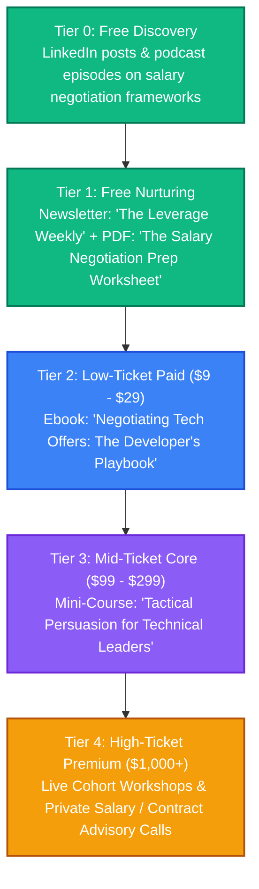

# Negotiation: Strategy & Content Pipeline

This directory is dedicated to brainstorming, drafting, and organizing content related to tactical communication, persuasion, and business negotiation.

---

## 👥 Persona & Track Positioning
*   **Track**: **Track A (Authority)**
*   **Persona**: Strategic Corporate/Tech Negotiator.
*   **Narrative**: *"How to claim your value, navigate difficult conversations, and build collaborative agreements without leaving money on the table."*
*   **Target Audience**: Mid-to-senior software engineers, tech managers, sales professionals, and freelancers seeking to negotiate salary, rates, or contracts.

---

## 📈 The Negotiation Value Ladder



---

## 📂 Folder Structure Setup

```text
📁 negotiation/
├── 📄 README.md                 # This overview
├── 📁 blog/                     # SEO blog posts on workplace/salary negotiation
├── 📁 podcast/                  # Audio transcripts of roleplays and scripts
├── 📁 courses/                  # Outline files for salary negotiation workshops
├── 📁 books/                    # Draft chapters for negotiation ebooks
├── 📁 assets/                   # Framework diagrams, cheat sheets, and templates
└── 📁 templates-and-code/       # Email script swipe-files, planner templates
```

---

## 💡 Raw Brain Dumps & Topic Ideas
*   *Idea 1*: "The 'No-Go' Email: How to reject a low-ball offer and get a 15% increase."
*   *Idea 2*: "BATNA (Best Alternative to a Negotiated Agreement) for developers: How to build multiple options."
*   *Idea 3*: "Navigating the 'What is your current salary?' trap without lying or losing leverage."
*   *Idea 4*: "The Psychology of Empathic Anchoring: How to set high expectations while building trust."
