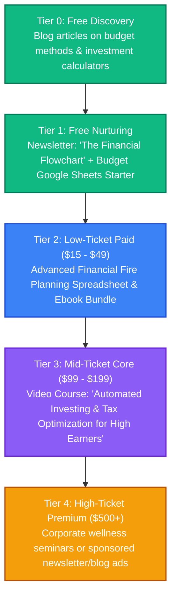

# Personal Finance: Strategy & Content Pipeline

This directory is dedicated to brainstorming, drafting, and organizing content related to money management, budgeting systems, long-term index investing, and financial independence.

---

## 👥 Persona & Track Positioning
*   **Track**: **Track A/B (Hybrid)**
*   **Persona**: Systematic Financial Simplifier.
*   **Narrative**: *"How to remove stress from money using simple math, automated savings, and long-term passive investing frameworks."*
*   **Target Audience**: High-earning professionals, freelancers, and builders who want automated, mathematically sound wealth accumulation without buying active stock alerts.

---

## 📈 The Personal Finance Value Ladder



---

## 📂 Folder Structure Setup

```text
📁 personal-finance/
├── 📄 README.md                 # This overview
├── 📁 blog/                     # SEO-optimized finance articles
├── 📁 podcast/                  # Transcripts of talks on compounding interest and tax math
├── 📁 courses/                  # Outline files for personal finance modules
├── 📁 books/                    # Draft books on automated financial management
├── 📁 assets/                   # Charts, sheets, print-on-demand designs
└── 📁 templates-and-code/       # Budget templates, FIRE retirement calculators (Notion/Sheets)
```

---

## 💡 Raw Brain Dumps & Topic Ideas
*   *Idea 1*: "The 3-Bucket System: How to automate your paycheck from day one."
*   *Idea 2*: "Compounding interest visual guide: What a 1% management fee actually costs you over 30 years."
*   *Idea 3*: "Asset allocation strategies: De-risking your portfolio as you approach financial independence."
*   *Idea 4*: "The Math of renting vs. buying: A developer's approach to housing costs."
