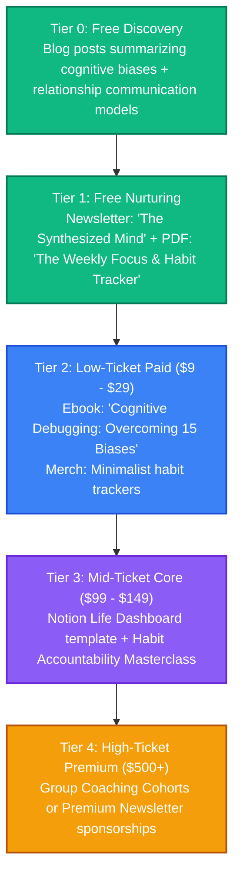

# Psychology & Personal Development: Strategy & Content Pipeline

This directory is dedicated to brainstorming, drafting, and organizing content related to cognitive psychology, habit formation, productivity frameworks, and relationship mechanics.

---

## 👥 Persona & Track Positioning
*   **Track**: **Track B (Curator)**
*   **Persona**: Practical Synthesizer & Growth Guide.
*   **Narrative**: *"Translating complex clinical research and developmental frameworks into actionable habits for modern life and relationships."*
*   **Target Audience**: High-performing professionals, creators, and individuals seeking to master their focus, build healthy relationships, and understand their own cognitive biases.

---

## 📈 The Psychology & Development Value Ladder



---

## 📂 Folder Structure Setup

```text
📁 psychology-and-development/
├── 📄 README.md                 # This overview
├── 📁 blog/                     # Summaries of psychological studies, productivity systems
├── 📁 podcast/                  # Transcripts of book summaries and reflections
├── 📁 courses/                  # Outline files for productivity & habit courses
├── 📁 books/                    # Draft chapters for self-development guides
├── 📁 assets/                   # Visual diagrams, habit worksheets, social graphics
└── 📁 templates-and-code/       # Notion templates, habit spreadsheets, journaling prompts
```

---

## 💡 Raw Brain Dumps & Topic Ideas
*   *Idea 1*: "The Dopamine Loop: How modern notifications hijacks your focus, and how to reset it."
*   *Idea 2*: "Nonviolent Communication (NVC) in Tech: Resolving peer conflicts without raising tension."
*   *Idea 3*: "The Planning Fallacy: Why your engineering estimates are always wrong, and how to fix them."
*   *Idea 4*: "The 5 Pillars of Relational Security: Building long-term personal and professional partnerships."
