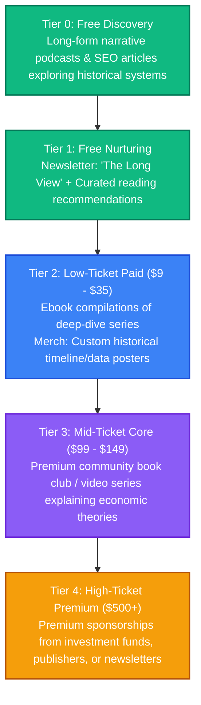

# Socioeconomic History: Strategy & Content Pipeline

This directory is dedicated to brainstorming, drafting, and organizing content related to historical economic cycles, structural geopolitical shifts, and the development of modern societies.

---

## 👥 Persona & Track Positioning
*   **Track**: **Track B (Curator)**
*   **Persona**: Historical Storyteller & Economic Synthesizer.
*   **Narrative**: *"Looking back at the structural shifts, technologies, and economic choices that created the modern world."*
*   **Target Audience**: History enthusiasts, economic thinkers, and individuals seeking to understand how past systems influence current geopolitical and financial conditions.

---

## 📈 The Socioeconomic History Value Ladder



---

## 📂 Folder Structure Setup

```text
📁 socioeconomic-history/
├── 📄 README.md                 # This overview
├── 📁 blog/                     # Detailed historical research papers/essays
├── 📁 podcast/                  # Transcripts of narrative audio episodes
├── 📁 courses/                  # Outline files for historical video summaries
├── 📁 books/                    # Draft manuscripts / ebook collections
├── 📁 assets/                   # Historical data charts, maps, POD designs
└── 📁 templates-and-code/       # Notion templates for tracing historical databases
```

---

## 💡 Raw Brain Dumps & Topic Ideas
*   *Idea 1*: "The Tulip Mania to South Sea Bubble: How the anatomy of speculative bubbles hasn't changed."
*   *Idea 2*: "How the steam engine rewrote global balance of power: An energy-centric view of history."
*   *Idea 3*: "The history of interest rates: 5,000 years of debt, default, and economic collapses."
*   *Idea 4*: "The printing press vs. the internet: Comparing the information shocks of 1440 and 1990."
