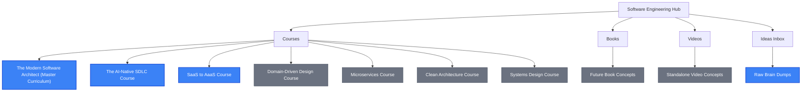

# Software Engineering Knowledge Hub

Welcome to my personal knowledge base and content creation pipeline for modern software engineering. This repository organizes my thoughts, research, drafts, and code related to books, video courses, and standalone educational content.

---

## 🗺️ Workspace Roadmap

This workspace is structured to track projects from ideation to completion.

---

## 📚 Content Pipeline

### 🎓 Courses
*   **[Flagship Masterclass]** **[The Modern Software Architect: Master Curriculum](courses/master-course-curriculum.md)**
    *   *Description*: A unified 17-section masterclass connecting Clean Architecture, DDD, Microservices, and Systems Design with Agentic AI, MCP, LangGraph, and the AI-Native SDLC.
    *   *Status*: 📋 Master Program Defined
*   **[Active]** **[The AI-Native SDLC: Building Software in the Era of Agentic AI](courses/agentic-ai/software-development/ai-native-sdlc/curriculum.md)**
    *   *Description*: A deep-dive curriculum exploring how modern software engineering teams leverage autonomous AI agents and AI-native workflows to conceptualize, write, test, and deploy applications.
    *   *Status*: 📝 Outlining & Content Generation
*   **[Active]** **[Transforming SaaS into AaaS (Agents as a Service)](courses/agentic-ai/software-products/saas-to-aaas/content/index.md)**
    *   *Description*: A comprehensive architectural outline for building production-ready agentic applications, covering stateful memory, multi-tenancy, MCP servers, and LLM gateways.
    *   *Status*: 📝 Outlining Topics
*   **[Planned]** **[Domain-Driven Design (DDD)](courses/ddd/content/index.md)**
    *   *Description*: Strategic and tactical modeling patterns to align software with complex business domains.
*   **[Planned]** **[Microservices Architecture](courses/microservices/content/index.md)**
    *   *Description*: Decoupling monolithic backends into scalable, fault-tolerant distributed systems.
*   **[Planned]** **[Clean Architecture](courses/clean-architecture/content/index.md)**
    *   *Description*: Concentric design boundaries to decouple core business domain logic from databases, UIs, and frameworks.
*   **[Planned]** **[Systems Design](courses/systems-design/content/index.md)**
    *   *Description*: High-level system scalability, caching, replication, sharding, and network design patterns.

### 📖 Books
*   **[Planned]** *The Autonomous Engineer*
    *   *Status*: 💡 Backlog
*   See [books/README.md](books/README.md) for more book concepts.

### 🎥 Standalone Videos & Tutorials
*   **[Planned]** *Getting Started with Cursor & Windsurf: Deep Dive*
*   **[Planned]** *Designing Markdown Blueprints for AI Coding Agents*
*   See [videos/README.md](videos/README.md) for scripts and video outlines.

---

## 📂 Repository Structure

*   📁 [courses/](courses/) — Directories for structured courses:
    *   📄 [master-course-curriculum.md](courses/master-course-curriculum.md) — Master Unified Software Engineering Curriculum.
    *   📁 [agentic-ai/software-development/ai-native-sdlc/](courses/agentic-ai/software-development/ai-native-sdlc/) — The AI-Native SDLC Course files.
    *   📁 [agentic-ai/software-products/saas-to-aaas/content/](courses/agentic-ai/software-products/saas-to-aaas/content/index.md) — Transforming SaaS into AaaS Course files.
    *   📁 [ddd/content/](courses/ddd/content/index.md) — Domain-Driven Design Course files.
    *   📁 [microservices/content/](courses/microservices/content/index.md) — Microservices Course files.
    *   📁 [clean-architecture/content/](courses/clean-architecture/content/index.md) — Clean Architecture Course files.
    *   📁 [systems-design/content/](courses/systems-design/content/index.md) — Systems Design Course files.
*   📁 [books/](file:///Users/maxtomasello/git/own/software-engineering/books/) — Book manuscripts, chapters, and proposal drafts.
*   📁 [videos/](file:///Users/maxtomasello/git/own/software-engineering/videos/) — Scripts, storyboards, and outline assets for short-form/long-form videos.
*   📁 [ideas/](file:///Users/maxtomasello/git/own/software-engineering/ideas/) — Quick brain dumps, raw thoughts, and undeveloped concepts.

