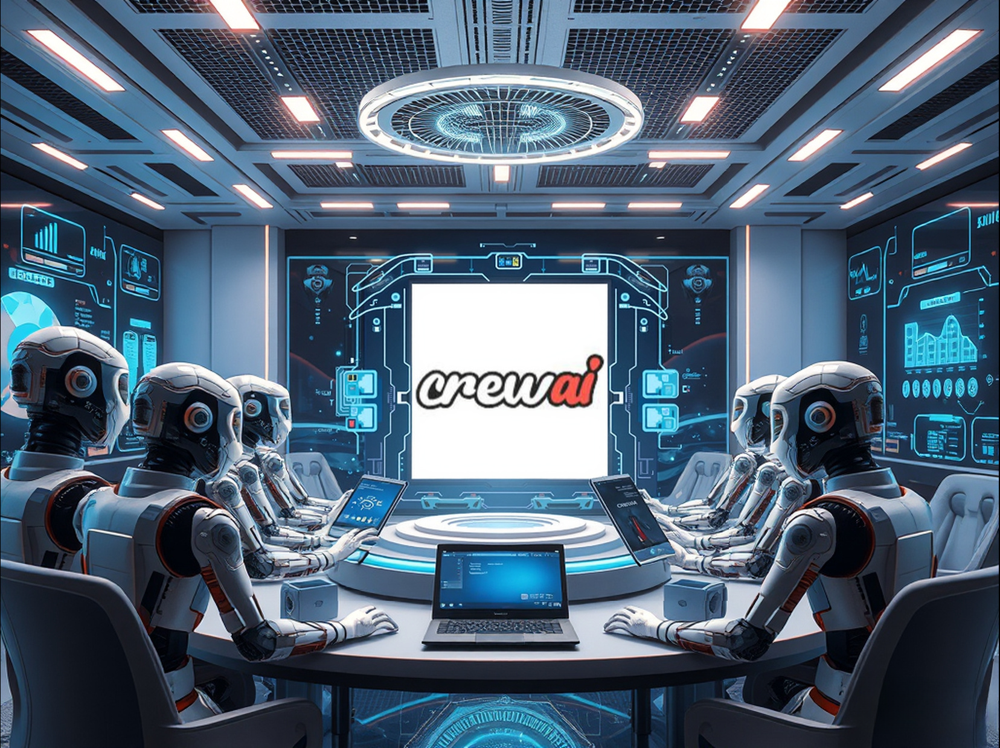
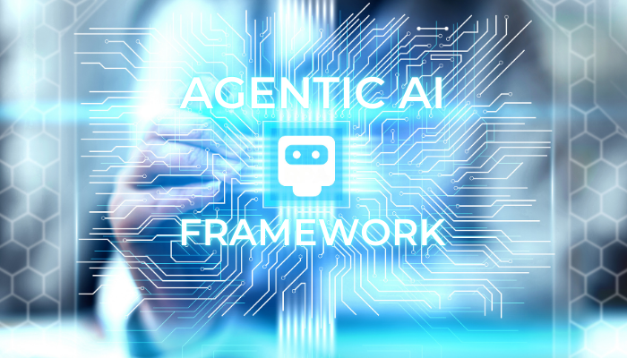

# Agentic AI in Action: Building with CrewAI - Part 1

**Objective:** Ready to build your own Agentic AI system? We’ll show you how, step-by-step, using CrewAI. Start with a single agent, then level up to a collaborative team. Get hands-on with real code and unlock the power of autonomous AI. Let’s build something amazing together!

**Medium Public Short Description:** 🚀 Dive into the future of autonomy! In Part 1 of Agentic AI in Action, we explore how to build powerful AI agents using CrewAI.



---

## Introduction

Agentic AI is transforming how we build intelligent systems by enabling autonomous decision-making and execution. While previous articles have explored the theoretical foundation and key technologies behind Agentic AI, this article takes a practical approach. We will demonstrate how to build an agentic AI system using CrewAI, a powerful framework designed for orchestrating autonomous agents.

---

## Understanding CrewAI and Its Capabilities

### What is CrewAI?
CrewAI is a specialized framework designed for developing and orchestrating agentic AI systems. It provides tools that allow multiple AI agents to work collaboratively, simulating human-like decision-making and teamwork to achieve complex objectives. By leveraging CrewAI, developers can implement single-agent and multi-agent architectures efficiently.

### Key Capabilities of CrewAI
*   **Agent Orchestration** – CrewAI enables the creation of agents with distinct roles and responsibilities, allowing seamless coordination between them.
*   **Task Delegation** – The framework supports structured workflows where agents assign and execute tasks dynamically based on real-time conditions.
*   **Perception, Reasoning, and Action Integration** – Agents can process inputs from multiple sources, analyze data, and execute actions autonomously.
*   **Inter-Agent Communication** – CrewAI facilitates smooth information exchange between agents, enabling collaborative problem-solving.
*   **Feedback Loops and Adaptability** – The system can refine its performance by integrating feedback from previous decisions and environmental changes.

---

## Core Concepts in CrewAI

To build effective Agentic AI systems, it is essential to understand CrewAI’s main components:
*   **Agent:** An autonomous entity capable of perceiving its environment, reasoning about tasks, and executing actions. Each agent can have specific roles and expertise.
*   **Task:** A discrete unit of work assigned to an agent. Tasks define what an agent needs to accomplish and may involve external data, reasoning, or interaction with other agents.
*   **Crew:** A collection of agents working together towards a shared goal. Crews allow for distributed problem-solving and collaboration among multiple agents.
*   **Flow:** The structured sequence of tasks and decision-making logic that governs how agents operate within a system. Flow ensures that agents complete tasks efficiently and in the right order.
*   **Memory:** A mechanism enabling agents to retain information from previous interactions, improving their decision-making over time.
*   **Tool:** External functions or resources that agents can utilize to perform specific actions. Tools extend an agent's capabilities, allowing them to interact with APIs, databases, or other external systems.



These core components provide the foundation for building intelligent, autonomous systems. With this understanding in place, we can now move on to constructing a single autonomous agent using CrewAI.

---

## Setting Up Your Development Environment

Before building our agentic AI system, we need to ensure that our development environment is properly set up. CrewAI requires a few dependencies, and it is recommended to follow the official documentation for the most up-to-date installation instructions.

To install CrewAI and its dependencies, refer to the official CrewAI documentation. The documentation provides detailed steps for setting up the framework using various package managers. Once you have CrewAI installed, you're ready to start developing your first agentic AI system.

---

## Initializing a New CrewAI Project

> [!NOTE]
> Before starting with CrewAI, you will need an LLM provider API key (such as OpenAI, Gemini, Anthropic, or Groq) in order for the agents to work.

With CrewAI successfully installed, the next step is to initialize a new project. This will provide us with a basic structure and example files.

Use the following command to initialize a new CrewAI project:

```bash
crewai create crew my_agentic_project
```

Replace `my_agentic_project` with your desired project name. This command will generate a new directory and populate it with the necessary boilerplate. The CLI will also prompt you to select your preferred LLM provider and input your API key.

---

## Understanding the Generated Project Structure

After running the project initialization command, you will find a directory structure organized as follows:

```
my-agentic-project/
├── knowledge/
├── src/
│   └── my-agentic-project/
│       ├── config/
│       │   ├── agents.yaml
│       │   └── tasks.yaml
│       ├── tools/
│       │   ├── __init__.py
│       │   └── custom_tool.py
│       ├── __init__.py
│       ├── crew.py
│       └── main.py
├── tests/
├── .env
└── pyproject.toml
```

The main files we will work with are:
*   **`agents.yaml`**: Contains the configurations and definitions for your AI agents (roles, goals, backstories).
*   **`tasks.yaml`**: Defines the specific tasks, expected outputs, and assigned agents.
*   **`.env`**: Stores environment variables and API credentials securely.
*   **`main.py`**: Entrypoint containing command-line hooks like run, train, test, and replay.
*   **`crew.py`**: The logic file where agents, tasks, and the orchestrating crew are initialized.
*   **`tools/`**: Directory where custom tool integrations are defined.
*   **`knowledge/`**: The knowledge base directory where documents can be stored for agent consumption.

---

## Demonstrating Core Agentic AI Concepts with CrewAI

In our previous article, "Understanding Agentic AI: Core Components Explained", we explored the fundamental concepts of Perception, Reasoning, Action, and Feedback. Let's see how these concepts manifest in a practical CrewAI example.

### Single-Agent Example: Market Research
One of the most valuable use cases for Agentic AI is automated Content Creation and Research. Imagine we want to create an agent that performs market research on a specific product and industry.

Here is how the core cognitive components translate to our agent:
*   **Perception:** The agent perceives details about the target product and industry through its task description and configuration parameters.
*   **Reasoning:** The agent analyzes the parameters, queries its environment (using search tools or LLM intelligence), and determines market potential.
*   **Action:** The agent writes and outputs a structured markdown report summarizing its findings.
*   **Feedback:** The user reviews the output and provides training feedback, which the agent incorporates on subsequent runs to improve its results.

#### 1. Define the Agent
Open `src/my_agentic_project/config/agents.yaml` and define the agent as follows:

```yaml
market_researcher:
  role: >
    {industry} Market Research Analyst
  goal: >
    Conduct thorough market research on a new product in the {industry} industry.
  backstory: >
    You are an experienced market research analyst with a focus on emerging technologies
    in the {industry} industry.
```

The `{industry}` parameter allows us to dynamically configure the agent's expertise for different sectors when executing the crew.

#### 2. Define the Task
Open `src/my_agentic_project/config/tasks.yaml` and define the research task:

```yaml
research_task:
  description: >
    Conduct market research on the '{product_name}' within the {industry} industry.
    Analyze online reviews, market reports, and competitor products.
    Identify key trends and assess the product's market potential.
    Generate a market research report.
  expected_output: >
    A comprehensive market research report that includes:
    an executive summary, market analysis, competitor analysis,
    trend identification, and market potential assessment.
    Formatted as markdown without '```'.
  output_file: single-agent-report.md
  agent: market_researcher
```

Here, we pass `{product_name}` and `{industry}` to parameterize the research execution and define `single-agent-report.md` as the direct file output.

#### 3. Create Your Crew
Open `src/my_agentic_project/crew.py` and implement the crew initialization logic:

```python
from crewai import Agent, Crew, Process, Task
from crewai.project import CrewBase, agent, crew, task

@CrewBase
class MyAgenticProject():
   """MyAgenticProject crew"""

   agents_config = 'config/agents.yaml'
   tasks_config = 'config/tasks.yaml'

   @agent
   def market_researcher(self) -> Agent:
       return Agent(
           config=self.agents_config['market_researcher'],
           verbose=True
       )

   @task
   def research_task(self) -> Task:
       return Task(
           config=self.tasks_config['research_task'],
           output_file='single-agent-report.md'
       )

   @crew
   def crew(self) -> Crew:
       """Creates the MyAgenticProject crew"""
       return Crew(
           agents=self.agents, 
           tasks=self.tasks, 
           verbose=True,
       )
```

#### 4. Pass Custom Inputs and Execute
Open `src/my_agentic_project/main.py` and modify the execution parameters:

```python
import sys
from my_agentic_project.crew import MyAgenticProject

def run():
   """
   Run the crew.
   """
   inputs = {
       'product_name': 'EduVerse',
       'industry': 'Immersive Educational Experiences'
   }
  
   try:
       MyAgenticProject().crew().kickoff(inputs=inputs)
   except Exception as e:
       raise Exception(f"An error occurred while running the crew: {e}")
```

Now, execute the following commands in your terminal from the project root:

```bash
crewai install
crewai run
```

Once the execution completes, a new file named `single-agent-report.md` will be created with the following research findings:

```markdown
# Market Research Report on EduVerse

## Executive Summary
EduVerse is an emerging immersive educational experience product designed to revolutionize how knowledge is imparted through advanced virtual and augmented reality technologies. This report presents a thorough analysis of online reviews, market trends, competitor products, and overall market potential. The demand for immersive education solutions has seen notable increases, particularly as remote and hybrid learning solutions become normalized. EduVerse holds significant promise in meeting educational needs globally.

## Market Analysis
The immersive educational experiences market has been experiencing robust growth. According to recent market reports, the global immersive education market was valued at approximately $1.8 billion in 2022, with expectations to grow at a compound annual growth rate (CAGR) of over 20% from 2023 to 2028. Key drivers include:
*   **Technological Advancements**: Innovations in VR/AR have made immersive tools more accessible and effective.
*   **Growing Distance Learning**: With remote education becoming mainstream, institutions are seeking engaging solutions.
*   **Increased Investment**: Both public and private sectors are investing heavily in educational technologies.

## Competitor Analysis
Several prominent competitors exist in the immersive educational space that EduVerse must contend with:
1.  **Nearpod**: A platform that combines interactive lessons with VR experiences, suitable for K-12 education.
2.  **ClassVR**: Offers a comprehensive suite of VR tools for schools and educators focusing on content delivery.
3.  **Immersive VR Education**: Known for VR-based training simulations, primarily for corporate and educational institutions.

## Trend Identification
Key trends identified within the immersive educational experiences industry include:
*   **Gamification of Learning**: Integrating gaming elements into educational content boosts engagement and retention.
*   **Personalized Learning**: Customizable educational experiences tailored to individual learner's needs are gaining traction.
*   **Collaboration Features**: Real-time interaction and collaboration tools are increasingly in demand to support group learning.
*   **Data Analytics**: Focused interests in leveraging data to assess student progress and improve educational strategies.

## Market Potential Assessment
The market potential for EduVerse appears promising, with the following assessments supporting this outlook:
*   **User Adoption**: Current online reviews indicate a positive reception toward immersive technologies in education, emphasizing user engagement and effectiveness.
*   **Institutional Adoption**: Educational institutions are increasingly incorporating technology into curricula, with many seeking innovative tools to remain competitive.
*   **Diverse Applications**: EduVerse can cater to a wide array of sectors, including K-12, higher education, vocational training, and corporate learning sectors.
```

---

## Improving the Agent Through Feedback

Let's assume we want to refine the report's recommendations. To trigger feedback-driven training, configure the `train` hook in `src/my_agentic_project/main.py`:

```python
def train():
   """
   Train the crew for a given number of iterations.
   """
   inputs = {
       'product_name': 'EduVerse',
       'industry': 'Immersive Educational Experiences'
   }
   try:
       MyAgenticProject().crew().train(n_iterations=int(sys.argv[1]), filename=sys.argv[2], inputs=inputs)
   except Exception as e:
       raise Exception(f"An error occurred while training the crew: {e}")
```

Run the training loop from your terminal:

```bash
crewai train -n 3 trained_agents_data.pkl
```

This commands executes a 3-iteration training cycle where the CLI prompts the user for feedback at each iteration. Let's provide the following feedback guidelines during the loop:
1.  *Add how recommendations can improve the product weaknesses.*
2.  *In the competitor analysis, include approximate user counts for each competitor.*
3.  *Add how many years in the market each competitor has.*

Following training, the agent generates the updated report:

```markdown
# Immersive Educational Experiences Market Research Report: 'EduVerse'

## Executive Summary
The 'EduVerse' is positioned as a groundbreaking product in the Immersive Educational Experiences industry, integrating cutting-edge technology such as VR and AR to improve learner engagement and knowledge retention. This report delves into the current market landscape, competitor offerings, user feedback, key trends, and potential growth opportunities for 'EduVerse.'

## Competitor Analysis
1.  **ClassVR**
    *   Users: Approximately 30,000 users
    *   Years in Market: 4 years
    *   Strengths: Robust hardware offerings and extensive content library.
    *   Weaknesses: Higher pricing and limited customization options.
2.  **zSpace**
    *   Users: Approximately 20,000 users
    *   Years in Market: 7 years
    *   Strengths: Strong emphasis on STEM education and interactivity.
    *   Weaknesses: Less focus on social and emotional learning elements.
3.  **Everfi**
    *   Users: Approximately 15,000 users
    *   Years in Market: 10 years
    *   Strengths: Broadly recognized for financial literacy and social issues educational content.
    *   Weaknesses: Less integration with immersive technologies compared to peers.

## Recommendations
1.  **Enhance User Customization**: Introduce customizable learning pathways that adapt to different learning speeds, overcoming a key competitor weakness.
2.  **Integrate Social-Emotional Learning Modules**: Develop content that aligns with emotional intelligence to attract a broader user base, as seen with successful competitors like Everfi.
3.  **Focus on Affordability**: Balance features with pricing to make 'EduVerse' more accessible to institutions and individual learners.
```

### Behind the Scenes: serialized training data
The framework saves your guidelines inside a serialized Python file named `trained_agents_data.pkl` at the project root. On future runs, the agent inspects this file to apply your formatting and analytical preferences:

```python
# Serialization view of trained_agents_data.pkl
{
  'Immersive Educational Experiences Market Research Analyst': {
    'suggestions': [
      'Incorporate user demographics and feedback into the market analysis section.',
      'Add user base statistics for key competitors.',
      'Include the number of years each competitor has been in the market.',
      'Elaborate on how recommendations address competitor weaknesses.'
    ],
    'quality': 9.0
  }
}
```

This makes deploying updates as simple as updating the serialized configuration file.

---

## Conclusion

This first part of our CrewAI journey showcased the power of a single agent, exemplified by our "EduVerse" market research analyst. We explored parameterizing agent roles, defining expected outputs, and even simulated learning through manual offline feedback. These techniques highlight CrewAI's ability to orchestrate autonomous tasks, laying the groundwork for more complex scenarios.

However, the true potential of Agentic AI lies in collaboration. In [Part 2: Multi-Agent Collaboration](file:///Users/maxtomasello/git/own/content-creation/software-engineering/agentic-ai-hub/blog/01-foundations-of-agentic-ai/06-agentic-ai-in-action-building-with-crewai-part-2/06-agentic-ai-in-action-building-with-crewai-part-2.md), we will expand this single agent into a collaborative crew, introducing task flows, dependencies, and complex role-playing.

---
*Generated as part of the [Agentic AI Hub](file:///Users/maxtomasello/git/own/content-creation/software-engineering/agentic-ai-hub/README.md) blueprint.*