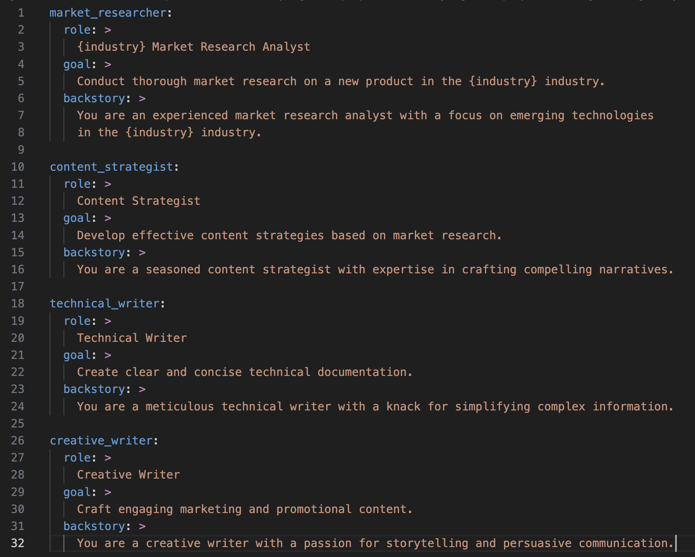
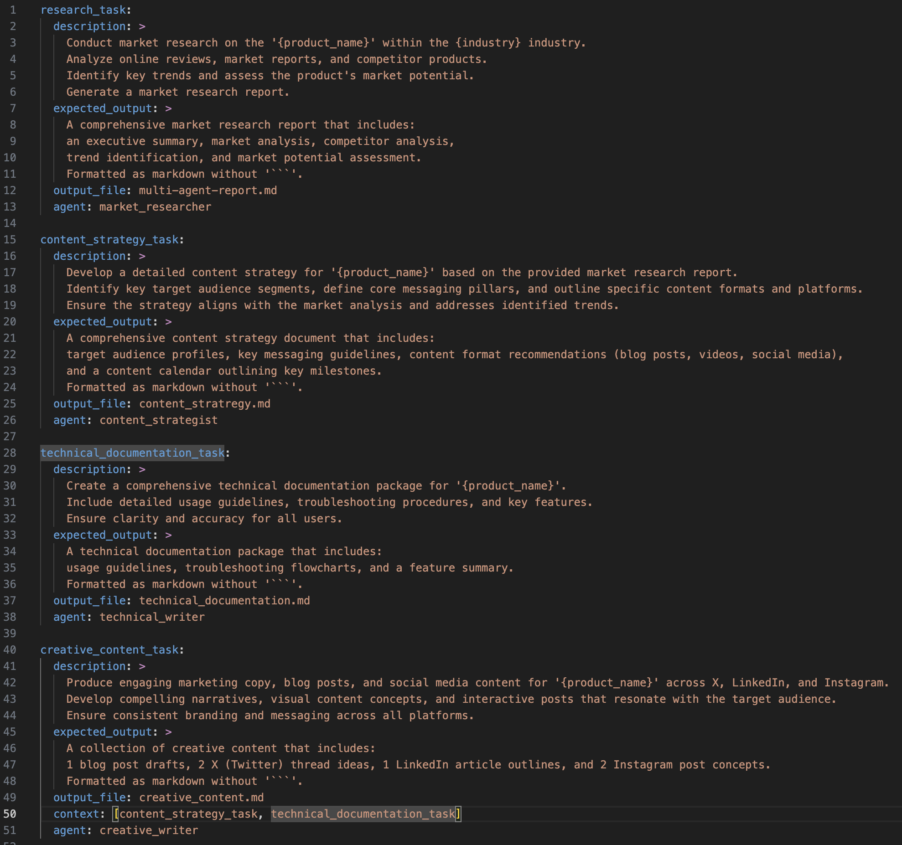

# Agentic AI in Action: Building with CrewAI - Part 2

**Objective:** Teamwork makes the dream work—especially in AI! See how CrewAI transforms a lone agent into a powerhouse team, crafting a full content package. Witness the magic of multi-agent collaboration and unlock new creative AI possibilities. Level up your AI game!

**Medium Public Short Description:** Part 2 explores how Agentic AI differs from traditional AI—and why it marks a key shift in the evolution of intelligent systems.


---

## Introduction

In [Part 1: Single Agent & Feedback Loop](file:///Users/maxtomasello/git/own/content-creation/software-engineering/agentic-ai-hub/blog/01-foundations-of-agentic-ai/05-agentic-ai-in-action-building-with-crewai-part-1/05-agentic-ai-in-action-building-with-crewai-part-1.md), we focused on a single agent, a market research analyst, tasked with investigating the "EduVerse" immersive educational platform. 

Now, we will expand this example to demonstrate how multiple agents can collaborate to create a comprehensive content package around the product. This shift allows us to explore a key aspect of CrewAI's capabilities: its potential for creative and collaborative tasks using sequential processes and dependencies.

---

## Expanding to a Content Creation Crew for EduVerse

Instead of focusing solely on market analysis, we will construct a crew (a multi-agent AI system) designed to produce a range of content for "EduVerse." This crew will leverage the single-agent's initial research and expand upon it.

Our "EduVerse" content creation crew will consist of the following agents:
*   **Market Research Analyst:** (From Part 1) Provides the foundational market research and competitor insights.
*   **Content Strategist:** Develops a content strategy based on the market research, identifying target audiences and key messaging.
*   **Technical Writer:** Creates detailed technical documentation and specifications for the "EduVerse" platform.
*   **Creative Writer:** Crafts engaging marketing copy, blog posts, and social media content to promote "EduVerse."

We will define specific tasks for each agent and establish a multi-agent crew with dependencies (using the `context` attribute) to ensure they execute in the right order.

Here is how the configuration files are defined:

*   **`src/my_agentic_project/config/agents.yaml`**:



*   **`src/my_agentic_project/config/tasks.yaml`**:



As you can observe in the `tasks.yaml` configuration, the `creative_content_task` contains the `context` attribute referencing previous tasks. This tells CrewAI to withhold execution until those specific dependencies have completed, passing their outputs as context to the creative writer.

To run this updated crew, update your crew initialization logic in `src/my_agentic_project/crew.py` to import and decorate the new agents and tasks, and then execute:

```bash
crewai run
```

The system will generate a complete, coordinated content package containing:
1.  **Market Research Report** (from the Analyst)
2.  **Content Strategy Blueprint** (from the Strategist)
3.  **Technical Specifications** (from the Technical Writer)
4.  **Marketing & Social Copy** (from the Creative Writer)

By allowing each agent to focus on their specialized domain and pass context down the line, we create a far more detailed and effective result than any single agent could achieve alone.

---

## Advanced Use Cases in CrewAI with Multi-Agent Systems

Now that we've built a foundational multi-agent system, let's explore some advanced use cases that showcase the true potential of CrewAI.

### Crew Process: Orchestrating Complexity
In our example, the agents executed tasks in sequential order (the default behavior of CrewAI). However, for more complex workflows, CrewAI supports a **hierarchical process**. In a hierarchical process, a manager agent (or a specialized manager LLM) acts as the conductor, dynamically assigning tasks, reviewing outcomes, and managing the workflow in real-time.

### Tool Augmentation: Supercharging Your Agents
Agents are powerful on their own, but they gain immense utility when equipped with **Tools**. CrewAI allows you to connect agents to external resources (such as web search APIs, SQL database connectors, file editors, or custom Python scripts), extending their capabilities beyond raw language generation.

### Task Delegation: Dynamic Workflows
CrewAI enables agents to delegate tasks to each other dynamically. If an agent determines that a sub-task is outside its area of expertise, it can spin up a request and delegate it to another agent in the crew, optimizing resource allocation on the fly.

### Flows: Blending Code and Crews
CrewAI's **Flows** feature allows you to seamlessly integrate Python code with your agentic workflows. This lets you construct state machines, conditional routing, loops, and custom logic layers that coordinate multiple crews and scripts within a single application.

### Multimodal Agents: Beyond Text
While we've focused on text-based interactions, CrewAI supports multimodal agents. Agents can be equipped to perceive and generate diverse media (including processing images, transcribing audio, or rendering charts), opening up applications in computer vision and media production.

---

## Conclusion: Building Foundations, Bridging Futures

With this exploration of multi-agent systems using CrewAI, we conclude our **Foundations of Agentic AI** module. We've traversed from defining Agentic AI's core principles to practical application, demonstrating CrewAI's capacity for creating collaborative AI crews. We've dissected perception, reasoning, action, and feedback, and illustrated CrewAI's versatility through the "EduVerse" content creation example.

This module has established a solid base for understanding how Agentic AI transcends mere automation, enabling systems to decide, adapt, and collaborate. 

In our next module, we will explore **Leveraging Large Language Models (LLMs)**, taking a deep dive into the reasoning engines that make these agents tick.

---
*Generated as part of the [Agentic AI Hub](file:///Users/maxtomasello/git/own/content-creation/software-engineering/agentic-ai-hub/README.md) blueprint.*