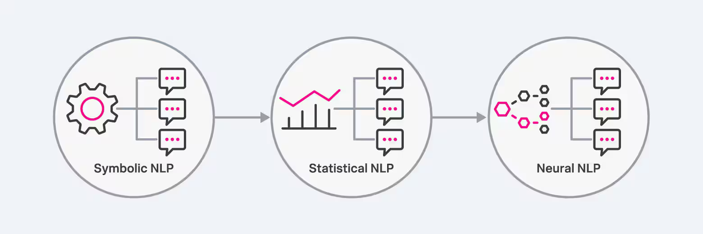

# Laying the Groundwork: An Introduction to Early Natural Language Processing

**Objective:** Discover the origins of Natural Language Processing! Explore early attempts to make machines understand language, from simple rule-based systems to the first neural sparks. See how these efforts led to today’s sophisticated Large Language Models (LLMs). Ready to explore the roots of AI text processing?

**Medium Public Short Description:** Part 1 of Module 2 takes a deep dive into the history of NLP—covering the foundations from Rule-Based Systems to early Neural Networks.

---

## Introduction

The remarkable capabilities of modern Large Language Models (LLMs) did not emerge overnight. They are the result of decades of research and innovation in the field of Natural Language Processing (NLP). Understanding their history is crucial to appreciating their potential and anticipating their future trajectory. Let's embark on a journey through time, exploring the key milestones that have shaped the evolution of LLMs.

---

## What is Natural Language Processing (NLP) and Why is it Important?

Natural Language Processing (NLP) is a branch of artificial intelligence that focuses on enabling computers to understand, interpret, and generate human language. It bridges the gap between human communication and machine understanding, allowing computers to process and analyze large volumes of text and speech data.

The importance of NLP lies in its ability to unlock the vast amount of information contained within human language. By enabling machines to understand and interact with language, NLP opens up a world of possibilities for automation, communication, and knowledge discovery.

---

## Natural Language Understanding (NLU) and Natural Language Generation (NLG): A Symbiotic Relationship

Natural Language Processing (NLP) is broadly divided into two main components: Natural Language Understanding (NLU) and Natural Language Generation (NLG). While they represent distinct processes, they are deeply interconnected and often work in tandem to enable sophisticated language-based interactions.

### Natural Language Understanding (NLU)
NLU focuses on enabling computers to comprehend the meaning and intent behind human language. It involves tasks such as parsing sentences, understanding context, and extracting relevant information.
*   **Sentiment Analysis:** Analyzing customer reviews to determine their emotional tone (e.g., positive, negative, neutral).
*   **Intent Recognition:** Identifying the user's goal in a query (e.g., "book a flight to London" indicates the intent to make a travel reservation).
*   **Entity Extraction:** Identifying and classifying named entities in text (e.g., names of people, organizations, locations).
*   **Question Answering:** Understanding a question and retrieving or generating an appropriate answer.

### Natural Language Generation (NLG)
NLG focuses on enabling computers to generate human-like text that is coherent, contextually relevant, and grammatically correct.
*   **Text Summarization:** Generating concise summaries of lengthy documents.
*   **Machine Translation:** Producing translations that are fluent and natural-sounding.
*   **Content Generation:** Creating articles, reports, or even creative writing based on input data.
*   **Chatbot Responses:** Generating natural and engaging responses in conversational interactions.

### The Interconnection
NLU and NLG form a symbiotic relationship, where the output of one often serves as the input for the other. Essentially, NLU provides the "understanding" that guides NLG's "generation."

*   **NLU as a Prerequisite for NLG:** For a system to generate meaningful and contextually relevant text, it must first understand the input. NLU performs this crucial task, extracting the intent, entities, and relationships from the input text. For example, in a chatbot, NLU analyzes the user's query to determine their intent, which then guides NLG in generating an appropriate response.
*   **NLG as a Reflection of NLU:** The quality and coherence of NLG output depend heavily on the accuracy and depth of NLU's understanding. If NLU misinterprets the input, NLG will produce irrelevant or nonsensical text. For example, in a machine translation system, accurate NLU of the source language is essential for NLG to generate a fluent and accurate translation in the target language.
*   **Iterative Interaction:** In conversational AI, NLU and NLG work iteratively, with each turn building upon the previous interaction. NLU analyzes the user's response, and NLG generates a follow-up question or statement, creating a dynamic and engaging dialogue.

In essence, NLU and NLG are two sides of the same coin, working together to enable machines to communicate with humans in a natural and intuitive way.

---

## The Evolution of NLP Techniques

The earliest attempts at NLP focused on enabling computers to process and understand human language through rule-based and statistical methods. These techniques, while limited compared to modern LLMs, laid the groundwork for future advancements.

### Early Natural Language Processing (NLP) Techniques
The roots of NLP can be traced back to the mid-20th century, with early attempts to create machines that could understand and generate human language. These early efforts focused on rule-based systems and statistical methods.

#### 1. Rule-Based Systems
These systems relied on manually crafted rules, typically in the form of if-then statements, to analyze and generate language. They were limited by their inability to handle the complexity and variability of human language. Linguists and programmers would define grammatical rules, syntactic structures, and semantic interpretations for specific language tasks. For example, a rule might specify how to identify the subject and verb in a sentence.

They had several limitations:
*   They were highly brittle and struggled with the inherent ambiguity and variability of human language.
*   Scaling these systems to handle large vocabularies and complex sentence structures was extremely difficult.
*   They required extensive manual effort and domain-specific knowledge.

Typical examples of these systems are early machine translation systems and simple chatbots that relied on predefined patterns.

#### 2. Symbolic AI (Knowledge Representation)
Symbolic Artificial Intelligence (AI) is a subfield of AI that focuses on the processing and manipulation of symbols or concepts, rather than numerical data. The goal of Symbolic AI is to build intelligent systems that can reason and think like humans by representing and manipulating knowledge and reasoning based on logical rules.

*   **Knowledge Representation:** Symbolic AI relied on creating explicit representations of knowledge using formal languages and data structures, including:
    *   **Semantic Networks:** Labeled nodes and arcs representing relationships between concepts. For example, "dog" might be connected to "mammal" through an "is-a" relationship.
    *   **Ontologies:** Formal representations of concepts, relationships, and constraints in a specific domain, providing an unambiguous structure.
*   **Inference Engines:** Apply logical rules to derive new knowledge from represented symbols:
    *   **Rule-Based Systems:** Use if-then rules to perform reasoning (e.g., "If X is a dog, then X is a mammal").
    *   **Logic Programming:** Languages like Prolog were used to implement logical reasoning and query knowledge bases.

Common implementations of Symbolic AI included:
*   **Parsing:** Applying grammatical rules and syntactic structures to analyze sentence grammar.
*   **Semantic Interpretation:** Deriving the meaning of sentences by mapping words to symbolic representations.
*   **Question Answering:** Querying knowledge bases and using inference engines to formulate answers.
*   **Early Machine Translation:** Using rule-based dictionaries and grammar mappings to translate text.

Despite their utility, Symbolic AI faced massive constraints:
*   **Knowledge Acquisition Bottleneck:** Manually encoding comprehensive, real-world knowledge was slow and labor-intensive.
*   **Vagueness and Ambiguity:** Natural language contains implicit meaning and vagueness that logical symbols cannot easily represent.
*   **Scalability & Robustness:** Systems were brittle, struggled to scale to large vocabularies, and easily broke when facing unexpected inputs.
*   **Lack of Learning:** Symbolic systems could not adapt or learn from new data, relying entirely on static rules.

#### 3. Statistical Models
These models used statistical techniques to predict the probability of the next word in word sequences, given the words that precede it. They were based on large text corpora and were more robust than rule-based systems, but still struggled with long-range dependencies and context. Key models included:
*   **N-grams:** Predict word probability based on the frequency of n-word combinations in a training corpus (e.g., a trigram predicts the next word based on the previous two).
*   **Hidden Markov Models (HMMs):** Model language as sequences of hidden states generating probability distributions over words, commonly used for part-of-speech tagging.
*   **TF-IDF (Term Frequency-Inverse Document Frequency):** Assigns weights to words based on their document and corpus frequency, widely used in information retrieval.

Limitations of statistical models:
*   They relied on shallow statistical patterns and struggled to capture long-range dependencies and semantic meaning.
*   They required large amounts of training data to achieve reasonable performance.
*   They often lacked the ability to understand context.

Typical applications of these statistical models included early spam filters, search engines, and basic part-of-speech taggers.

---

## The Evolution from Statistical Models to Neural Networks

The late 20th and early 21st centuries marked a significant transition in NLP, moving from reliance on statistical models to the adoption of neural networks. This shift was driven by the increasing availability of computational power and the realization that neural networks could learn more complex patterns and representations of language.

As mentioned, statistical models struggled to capture deeper semantic meaning or long-range dependencies in text and often treated words in isolation, failing to capture the context in which they appeared. Neural networks, inspired by the structure of the human brain, offered a more flexible and powerful approach to NLP:
*   **Distributed Representations:** Neural networks represented words and phrases as dense vectors, capturing semantic relationships in a continuous vector space. This allowed for more nuanced and flexible representations compared to symbolic or statistical methods.
*   **Automatic Feature Learning:** Unlike statistical models that relied on manually engineered features, neural networks could automatically learn relevant features from the data.
*   **Ability to Capture Long-Range Dependencies:** Neural networks, particularly Recurrent Neural Networks (RNNs), showed promise in capturing long-range dependencies in sequential data like text.

---

## Conclusion

This exploration of the early stages of NLP reveals a progression from rule-based and statistical methods to the dawn of neural networks. Each phase contributed crucial insights and techniques, ultimately paving the way for the sophisticated language models we see today. The shift to neural networks, with their ability to learn complex representations and capture long-range dependencies, marked a turning point. 

In our next article, [A Journey Through Time: The History of Large Language Models](file:///Users/maxtomasello/git/own/content-creation/software-engineering/agentic-ai-hub/blog/02-leveraging-large-language-models-llms-for-agentic-ai/02-a-journey-through-time-the-history-of-large-language-models/02-a-journey-through-time-the-history-of-large-language-models.md), we will explore the evolution of neural networks from feed-forward networks and RNNs to the groundbreaking Transformer architecture that powers today's AI agents.