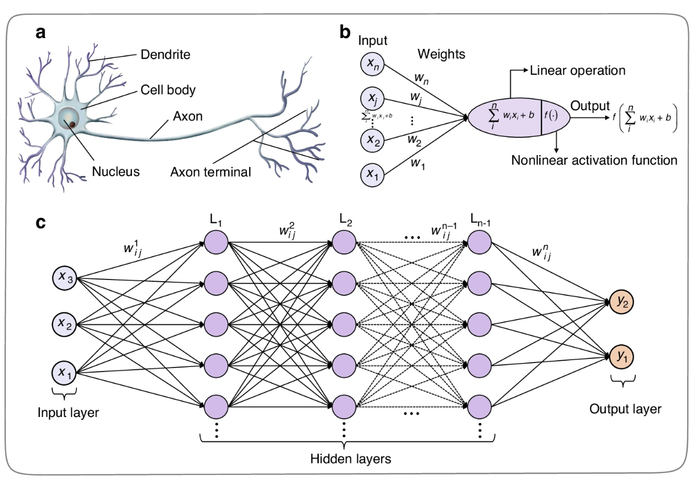
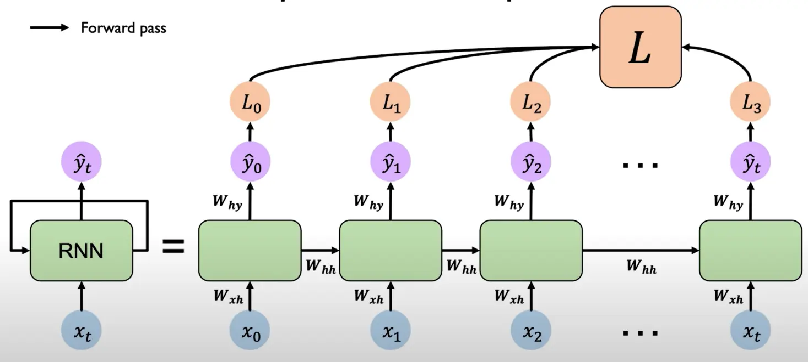
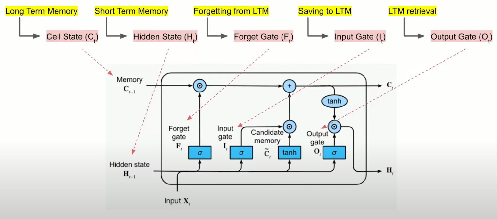
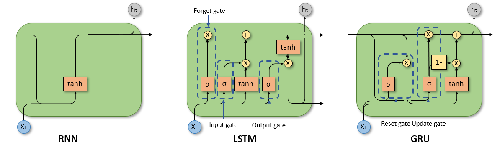
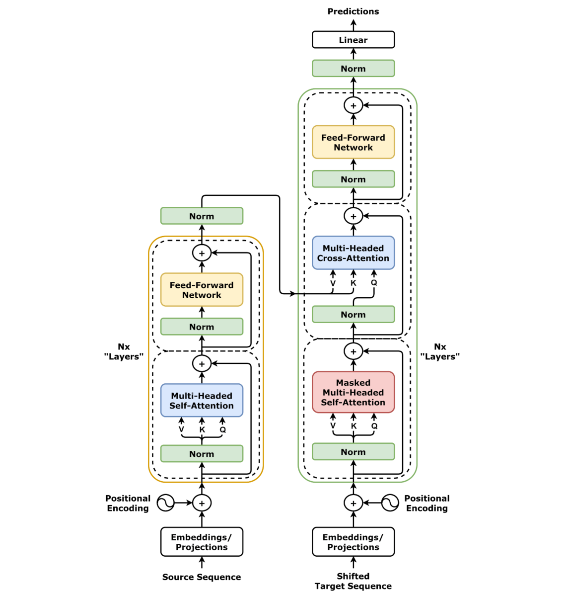

# A Journey Through Time: The History of Large Language Models

**Objective:** Neural networks take center stage! Follow the evolution of Large Language Models, from early sequence learning to the pivotal rise of recurrent architectures and attention. Discover the key innovations that paved the way for the intelligent agents of today. Ready for a history lesson that rewrites the future?

**Medium Public Short Description:** Part 2 of Module 2 covers the transition from traditional Artificial Neural Networks to Recurrent Networks, LSTMs, GRUs, and the birth of Attention.

---

## Introduction

In the realm of Agentic AI, where systems autonomously perceive, reason, and act, Large Language Models (LLMs) stand as the core intelligence driving these capabilities. They are the "brains" that enable agents to understand and generate human-like text, interpret complex instructions, and even engage in sophisticated reasoning. But how did these neural architectures evolve to handle the complexities of language with increasing proficiency? Let's trace their history from foundational neural networks to the attention-driven Transformer paradigm.

---

## Artificial Neural Networks: The Foundation

At the core of LLMs, and indeed most modern AI, are Artificial Neural Networks (ANNs). These are computational models inspired by the structure and function of biological neural networks. ANNs consist of interconnected nodes, or "neurons," organized in layers. Each connection between neurons has a weight, which is adjusted during training to optimize performance.

Key components of ANNs:
*   **Layers:** ANNs typically have an input layer, one or more hidden layers, and an output layer.
*   **Neurons:** Each neuron receives inputs, applies a mathematical function (activation function), and produces an output.
*   **Weights:** Determine the strength of connections between neurons and are learned through training.
*   **Activation Functions:** Introduce non-linearity, allowing the network to learn complex, non-linear relationships.

Deep Learning, a subfield of machine learning, leverages ANNs with numerous hidden layers—hence the "deep" aspect—to automatically learn hierarchical representations of data. This ability to extract abstract features from raw input enabled deep learning to tackle complex vision and speech tasks.

However, traditional feed-forward deep learning architectures struggled with sequential data like text, since they process inputs in isolation and have no memory of preceding tokens.

---

## Recurrent Neural Networks (RNNs): An Early Attempt at Sequential Data

To address the limitations of feed-forward networks on sequence-based data, researchers developed Recurrent Neural Networks (RNNs). RNNs process input sequences one element at a time, maintaining an internal "memory" of past inputs through a hidden state.

*   **Sequential Processing:** RNNs process input sequences token by token, updating a hidden state at each step.
*   **Hidden State:** Acts as a memory vector, carrying context from previous time steps to influence the current prediction.

Depending on the task, different RNN architectures can be configured to provide specific mappings:
*   **One-to-One:** Standard classification without sequence processing.
*   **One-to-Many:** Takes a single input and generates a sequence (e.g., image captioning).
*   **Many-to-One:** Processes a sequence and outputs a single value (e.g., sentiment analysis).
*   **Many-to-Many:** Translates an input sequence to an output sequence (e.g., machine translation).

### The Vanishing and Exploding Gradient Problem
Despite their design, standard RNNs suffered from a critical limitation: the **vanishing/exploding gradient problem**. During training via Backpropagation Through Time (BPTT), gradients are multiplied repeatedly. Over long sequences, these gradients either shrink to zero (vanishing) or grow exponentially (exploding). This made it mathematically difficult for RNNs to retain long-range dependencies, limiting their context to only a few preceding words.

---

## Long Short-Term Memory (LSTM): Addressing Long-Range Dependencies

To overcome the vanishing gradient problem, Sepp Hochreiter and Jürgen Schmidhuber introduced Long Short-Term Memory (LSTM) networks in 1997. LSTMs introduce a dedicated cell state alongside gating mechanisms to regulate the flow of information.

Key components of LSTMs:
*   **Cell State:** Acts as an information highway, running straight down the entire chain with only minor linear interactions, preserving gradients.
*   **Gating Mechanisms:** Three gates control what information is added, modified, or removed:
    *   **Forget Gate:** Decides which information to discard from the cell state.
    *   **Input Gate:** Determines which new information to store in the cell state.
    *   **Output Gate:** Controls what information from the cell state is emitted to compute the next hidden state.

These gates enable LSTMs to selectively remember or forget information, allowing them to capture long-range dependencies more effectively than classic RNNs.

---

## Gated Recurrent Units (GRUs): A Simplified Alternative

Introduced by Kyunghyun Cho et al. in 2014, Gated Recurrent Units (GRUs) offer a simplified alternative to LSTMs, achieving similar performance with a more computationally efficient structure.

Key simplifications in GRUs:
*   **Merged Gates:** Combine the input and forget gates into a single **update gate**, and use a **reset gate** to control how much past information to ignore.
*   **No Dedicated Cell State:** Merge the cell state and hidden state, reducing parameter counts and memory overhead.
*   **Efficiency:** Due to their simpler structure, GRUs are faster to train and execute while matching LSTM performance on many NLP tasks.

---

## The Encoder-Decoder Paradigm: A Framework for Sequence Tasks

While LSTMs and GRUs improved sequence modeling, sequence-to-sequence (seq2seq) tasks like machine translation required mapping an input sequence of length $N$ to an output sequence of length $M$. This led to the adoption of the **Encoder-Decoder paradigm**.

*   **The Encoder:** Processes the input sequence token by token, condensing the entire sequence into a single, fixed-length context vector (typically the final hidden state of the RNN).
*   **The Decoder:** Receives this context vector as its initial state and generates the output sequence step by step.

### The Bottleneck Problem
Despite its utility, this architecture faced a major bottleneck:
*   **Information Compression:** The encoder must compress all semantic meaning from a potentially long sentence into a single, fixed-size context vector. 
*   **Decoder Isolation:** The decoder relies solely on this static vector, losing access to specific input tokens that might be highly relevant when generating a particular output word.

---

## The Innovation of Attention: Focusing on What Matters

To resolve the bottleneck problem, Dzmitry Bahdanau et al. introduced the **Attention Mechanism** in 2014. Instead of forcing the decoder to rely on a single context vector, attention allows the model to "focus" on different parts of the input sequence dynamically.

*   **Selective Focus:** The decoder computes alignment scores between its current state and all encoder hidden states.
*   **Dynamic Context Vector:** The decoder computes a weighted sum of the encoder hidden states at each step, focusing only on the relevant input words.
*   **Improved Performance:** Attention dramatically improved machine translation quality, especially for long, complex sentences.

---

## Transformers: Attention is All You Need

While attention improved performance, encoder-decoder models still relied on underlying recurrent structures (LSTMs/GRUs), which processed tokens sequentially and prevented parallel training. 

In 2017, Vaswani et al. published the landmark paper *Attention is All You Need*, introducing the **Transformer** architecture. The Transformer completely discarded recurrence, relying entirely on self-attention mechanisms to model relationships between words in parallel.

Core mechanisms of the Transformer:
*   **Self-Attention:** Enables the model to calculate relationships between all words in a sequence simultaneously, mapping context in parallel without recurrence.
*   **Multi-Head Attention:** Runs multiple attention mechanisms in parallel, allowing the model to focus on different syntactic and semantic representation subspaces at the same time.
*   **Feed-Forward Networks:** Process the attended representations independently at each position, adding non-linearity.

These mechanisms enable LLMs to learn deep semantic context, forming the cognitive reasoning engines that power modern Agentic AI.

---

## Conclusion

The progression of neural networks for language processing—from RNNs, LSTMs, and GRUs to the attention-driven encoder-decoder framework—marked significant strides in modeling linguistic complexity. These architectures paved the way for the Transformer, a paradigm shift that enables parallel processing and scales to massive datasets.

In our next article, [LLMs: The Brains Behind Intelligent Agents](file:///Users/maxtomasello/git/own/content-creation/software-engineering/agentic-ai-hub/blog/02-leveraging-large-language-models-llms-for-agentic-ai/03-llms-the-brains-behind-intelligent-agents/03-llms-the-brains-behind-intelligent-agents.md), we will dissect the Transformer processing pipeline, tracing how text is tokenized, embedded, and computed using self-attention to generate intelligent responses.