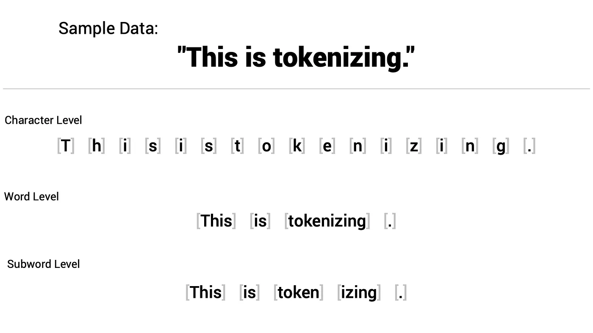
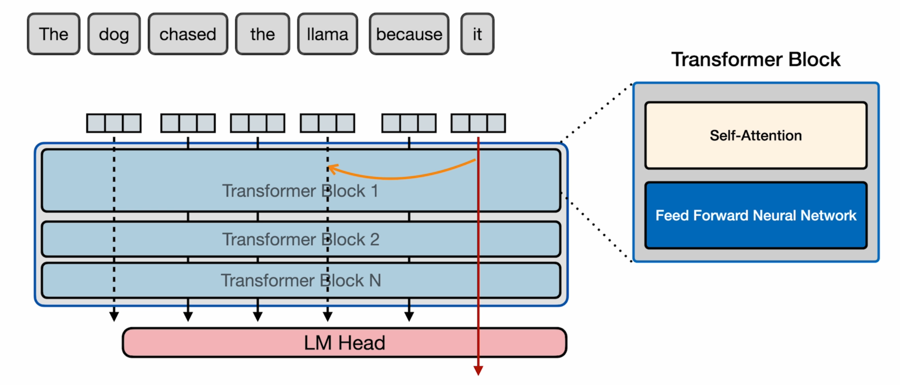
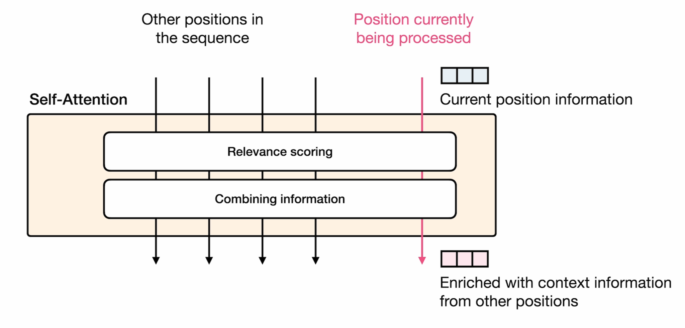
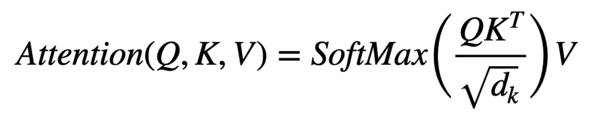
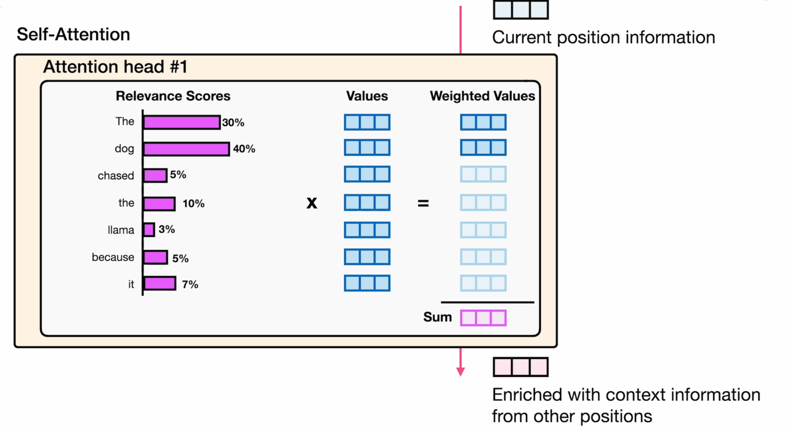
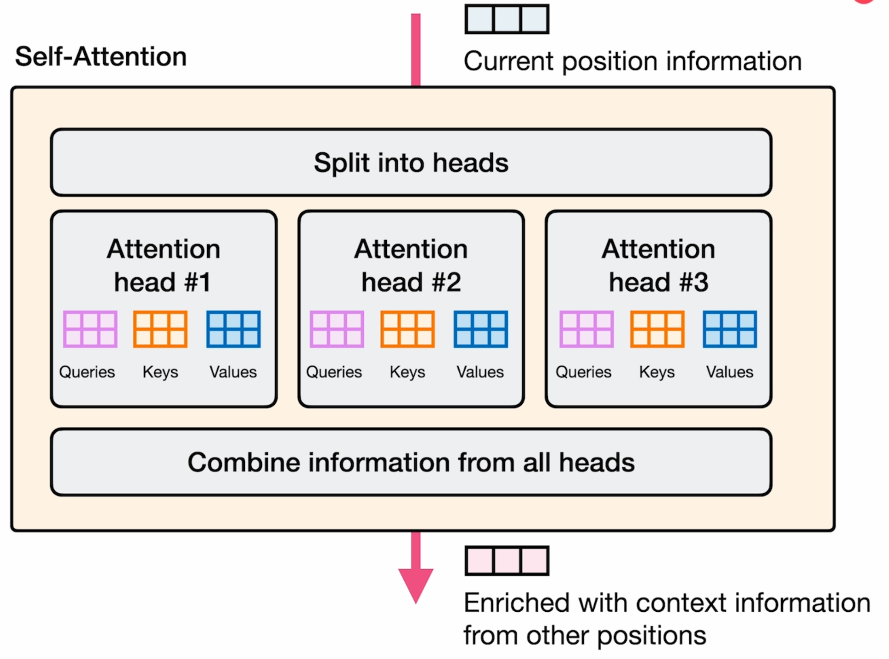
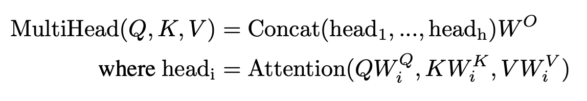

# LLMs: The Brains Behind Intelligent Agents

**Objective:** Discover the Transformer architecture at the heart of Large Language Models, the driving force of Agentic AI. Explore its core mechanisms and key variants. We'll also touch on current LLM challenges, setting up future discussions on enhancing these intelligent agents. Ready to understand the intelligence behind these powerful models?

**Medium Public Short Description:** Part 3 of Module 2 dives deep into the Transformer processing pipeline—covering Tokenization, Embeddings, Positional Encoding, and Self-Attention.

---

## Introduction

Our journey through the history of Large Language Models brought us to the revolutionary Transformer architecture, the foundation of today's most powerful language models and the driving force behind Agentic AI. These LLMs act as the 'brains' of intelligent agents, enabling them to understand, generate, and interact with the world in complex ways. Understanding the Transformer is key to grasping the potential of autonomous AI.

In this article, we'll delve into the core of the Transformer, exploring its fundamental mechanisms and the key architectural variations that have arisen. We'll also briefly address the current limitations of these models. This exploration will lay the groundwork for future discussions on how LLMs are further enhanced to power truly intelligent and autonomous agents.

---

## The Original Transformer Architecture: A High-Level Look

The Transformer architecture, introduced in 2017 by the paper *Attention is All You Need*, revolutionized sequence processing by moving away from the sequential nature of Recurrent Neural Networks (RNNs). RNNs struggled with long-range dependencies and parallelization. The Transformer's core innovation is self-attention, a mechanism that allows each word in an input sequence to directly attend to all other words, computing a context-aware representation in parallel. This eliminates the sequential bottleneck and enables the model to capture relationships across the entire sequence more effectively.

The self-attention process involves transforming each input word into Query (Q), Key (K), and Value (V) vectors. The relevance between words is determined by the dot product of their Query and Key vectors, which is then used to weight the Value vectors. Multi-head attention further enhances this by performing the self-attention process multiple times with different sets of Q, K, and V transformations, allowing the model to capture diverse relationships within the data. To maintain the sense of sequence without recurrence, positional encodings are added to the input embeddings, providing the model with information about the position of each word.

The original Transformer architecture comprises stacked encoder and decoder layers. The encoder processes the input sequence through multiple layers of self-attention and feed-forward networks. The decoder, responsible for generating the output, has a similar structure but includes an additional attention layer over the encoder's output and a masking mechanism during training to ensure autoregressive generation. Residual connections and layer normalization are used throughout both the encoder and decoder to facilitate training and improve performance.

---

## From Input to Output: Tracing the Transformer's Processing Pipeline

To understand how Large Language Models achieve their remarkable abilities, we need to explore the inner workings of the Transformer architecture. This section will trace the Transformer's processing pipeline, following the journey of text from its initial input to the final generated output.

### From Text to Tokens: Preparing the Input
The journey of understanding or generating language for a Transformer begins with transforming raw text into a format the model can process: a sequence of numerical representations. This initial step is called tokenization.

Imagine you have a sentence like: *"The quick brown fox jumps over the lazy dog."* The tokenizer breaks this continuous string of characters into discrete units called tokens. These tokens can be words, subwords, or even individual characters, depending on the specific tokenization method used.

Common tokenization techniques include simple word-based splitting (often based on spaces and punctuation), and more sophisticated subword tokenization methods like Byte-Pair Encoding (BPE) or WordPiece. Subword tokenization is particularly effective in handling large vocabularies and rare or out-of-vocabulary words by breaking them down into smaller, more frequent units. For example, *"unbelievable"* might be tokenized into *"un"*, *"##believ"*, *"##able"*.

| Tokenization Type | Description | Use Cases |
| :--- | :--- | :--- |
| **Word Tokenization** | Breaks text into individual words. | Effective for languages with clear word boundaries like English. |
| **Character Tokenization** | Segments text into individual characters. | Useful for languages without clear word boundaries or granular character-level tasks. |
| **Subword Tokenization** | Breaks text into units larger than characters but smaller than words. | Beneficial for languages with complex morphology or handling out-of-vocabulary words. |

The output of this stage is a sequence of tokens, ready to be further processed into numerical embeddings.

### Embedding the Tokens: Representing Meaning
Once the raw text has been broken down into a sequence of tokens, the next crucial step is to convert these discrete units into a numerical format that the neural network can process. This is achieved through embedding.

During the embedding process, each token is transformed into a dense, low-dimensional vector known as a word (or sentence) embedding. These embeddings are learned during the training process on a massive corpus of text. The key idea behind word embeddings is to capture semantic meaning and relationships. Words used in similar contexts will have embeddings close to each other in the vector space (e.g., the vectors for "king" and "queen" will be closer than "king" and "apple").

Think of these embeddings as representing the essence of a word in numerical form, where the numbers in the vector encode different aspects of its meaning and its relationships with other words.

### Positional Encoding: Injecting Sequence Information
Because the Transformer processes all tokens in the input sequence simultaneously (unlike RNNs which process sequentially), it loses the inherent information about the order of the words. To address this, positional encodings are added to the word embeddings. These are vectors whose values are determined by the position of the token within the sequence.

By adding the positional encoding to the word embedding, each token's representation now carries information about both its meaning (from the word embedding) and its location within the sentence.

The Transformer paper proposed generating these positional encodings using sine and cosine functions of different frequencies. The key idea is that these trigonometric functions allow the model to easily learn relative positions.

The formulas used to calculate the positional encoding for a token at position $pos$ and dimension $i$ within the embedding vector are:

Where:
*   $pos$ is the position of the token in the input sequence (starting from 0).
*   $i$ is the dimension index within the embedding vector (ranging from $0$ to $d_{model}/2 - 1$).
*   $d_{model}$ is the dimensionality of the word embeddings.
*   $10000$ is a constant scaling factor.

Even dimensions of the positional encoding vector are calculated using the sine function, while odd dimensions use the cosine function. The frequency of these sine and cosine waves decreases as the dimension index $i$ increases, creating a unique "fingerprint" for each position.

By adding this positional information to the word embeddings, the Transformer can take into account the order of words while still benefiting from parallel processing.

### Entering the Encoder: Understanding the Input Context
With the input text now represented as a sequence of embedded tokens (combining word meaning and positional information), the Transformer processes it through the encoder stack. Each encoder layer takes the output from the previous layer and processes it to produce a more contextually rich representation.

Each encoder layer (or Transformer Block) is composed of two major components:
1.  **Self-Attention component**
2.  **Feed Forward Neural Network component**

### Self-Attention Mechanism: Connecting Words Within the Sequence
In the Transformer architecture, at the core of the encoder lies the self-attention mechanism. This component allows each word in the input sequence to directly interact with and understand its relationship to all other words in the same sequence. Instead of processing sequentially, self-attention enables the model to identify which other words are most relevant when interpreting a given word.

For instance, in the sentence: *"The dog chased the llama because it was fast."* 
When processing the token "it", self-attention allows the model to compute a strong relationship between "it" and "llama" or "dog" depending on context.

Inside the self-attention component, the Transformer performs two tasks:
*   **Relevance Scoring:** Assigns a score indicating how relevant each input token is to the token currently being processed.
*   **Combining Information:** Combines the relevant token vectors into an enriched vector representation.

This is achieved through a series of matrix multiplications that calculate attention scores based on the Query (Q), Key (K), and Value (V) vectors derived from the input embeddings.

Let's say we have an input sequence of embedded tokens $X = [x_1, x_2, \dots, x_n]$, where each $x_i$ is the embedding vector for the $i$-th token. To obtain the Query, Key, and Value matrices for the entire sequence, we multiply this input matrix $X$ by three weight matrices ($W^Q$, $W^K$, and $W^V$):

$$Q = X W^Q, \quad K = X W^K, \quad V = X W^V$$

The attention weights and output are calculated as:

$$\text{Attention}(Q, K, V) = \text{softmax}\left(\frac{Q K^T}{\sqrt{d_k}}\right) V$$

Where:
*   $X$ is the input embedding matrix of shape $(n, d_{model})$.
*   $W^Q$, $W^K$ are Query and Key weight matrices of shape $(d_{model}, d_k)$.
*   $W^V$ is the Value weight matrix of shape $(d_{model}, d_v)$.
*   $\sqrt{d_k}$ is the scaling factor used to prevent dot products from growing excessively large in high dimensions.
*   The **softmax** function converts similarity scores into a probability distribution (relevance percentages).

The matrix multiplication $Q K^T$ calculates similarity scores between all tokens in the sequence. Applying softmax converts these into attention weights, which then scale the Value matrix $V$ to produce context-aware representations.

### Multi-Head Attention: Parallelizing Context
To capture diverse relationships within language, the Transformer applies attention multiple times in parallel. This is called **Multi-Head Attention**.

In Multi-Head Attention, the Query, Key, and Value matrices are projected $h$ times using different learned weight matrices ($W^Q_i$, $W^K_i$, $W^V_i$). Each projection is fed into an independent attention head.

Why is this necessary? A single attention head might focus on grammatical dependencies (e.g., matching verbs to nouns), while another captures semantic links (e.g., connecting pronouns to referents), and another focuses on temporal associations. Combining these heads yields a much richer representation of context.

After each of the $h$ attention heads computes its output, these outputs are concatenated and linearly projected back to the original dimensionality using the output weight matrix $W^O$.

### Add & Norm (Residual Connections and Layer Normalization)
After passing through the attention layer, the output is routed through a sub-layer containing:
1.  **Residual Connections:** The input to the attention layer is added directly to its output ($x + \text{Sublayer}(x)$). This bypass mechanism allows gradients to flow directly through the network during backpropagation, mitigating the vanishing gradient problem in deep stacks.
2.  **Layer Normalization:** Normalizes the activations across features for each token position, stabilizing hidden state dynamics and accelerating training convergence.

### Feed-Forward Network
Following the attention and normalization steps, the representation for each token passes through a position-wise Feed-Forward Network (FFN). This network consists of two linear transformations with a non-linear activation (typically ReLU or GELU) in between:

$$\text{FFN}(x) = \max(0, x W_1 + b_1) W_2 + b_2$$

This FFN is applied to each token position individually and identically, adding non-linear capacity to the model.

---

## The Decoder: Generating the Output Sequence

While the encoder processes the input text, the decoder is responsible for generating the target sequence autoregressively (one token at a time).

The decoder layer contains three primary sub-layers:
1.  **Masked Self-Attention:** Similar to the encoder's self-attention, but applies a causal mask to prevent the decoder from attending to future tokens. This ensures that the prediction for the $t$-th token relies only on generated tokens at positions $< t$.
2.  **Encoder-Decoder Attention:** Queries are projected from the decoder's previous layer, while Keys and Values come from the encoder's output. This allows the decoder to "look back" at the source context while generating the target sequence.
3.  **Feed-Forward Network:** Processes the combined context to refine the next token representation.

### Linear Layer and Softmax (Final Output)
The output vector from the final decoder layer is passed through a **Linear Layer** that projects it onto the size of the model's vocabulary, generating logits. A **Softmax** function is then applied to turn these logits into probability distributions. The token with the highest probability is selected as the next generated word.

---

## Transformer Variants: Adapting the Foundation

Since its introduction, the Transformer architecture has been adapted into three main variants:

### 1. Encoder-Only Models (e.g., BERT, RoBERTa)
*   **Architecture:** Consists only of encoder layers, allowing bidirectional attention across all tokens.
*   **Strengths:** Excels at language understanding, text classification, named entity recognition, and question answering.

### 2. Decoder-Only Models (e.g., GPT family, LLaMA)
*   **Architecture:** Consists only of decoder layers with causal masking.
*   **Strengths:** Excels at autoregressive text generation, writing assistance, conversational dialogue, and in-context learning.

### 3. Encoder-Decoder Models (e.g., T5, BART)
*   **Architecture:** Retains the full original encoder and decoder stack.
*   **Strengths:** Highly versatile for sequence-to-sequence mappings such as machine translation, document summarization, and text rewriting.

---

## Current Problems and Limitations of LLMs

While LLMs serve as powerful cognitive engines for Agentic AI, they face notable limitations:
*   **Context Window Limits:** Processing extremely long documents remains computationally expensive due to the quadratic complexity of self-attention.
*   **Computational Cost:** Training and executing large models requires massive GPU compute resources.
*   **Interpretability:** Deep neural representations are "black boxes," making it difficult to explain specific model outputs.
*   **Hallucinations:** LLMs generate text based on probability, which can lead to highly confident but factually incorrect assertions.
*   **True Logical Reasoning:** While LLMs capture associations, they struggle with multi-step symbolic logic and common-sense arithmetic without external tooling.

---

## The Role of LLMs in Perception, Reasoning, and Action

In Agentic AI, LLMs play a pivotal role in each core cognitive stage:
*   **Perception:** Convert textual inputs (instructions, environment states, or documents) into rich, context-aware embeddings using self-attention.
*   **Reasoning:** Formulate multi-step action plans, break down complex tasks, and evaluate logical outcomes (e.g., using chain-of-thought).
*   **Action:** Generate structured outputs, write responses, or output program commands (like tool calls and API executions) to interact with the environment.

---

## Conclusion

The history of LLMs is a testament to the pursuit of language-understanding machines. From early rule-based structures to the parallelized Transformer, each step has enhanced language representation. 

In our next module, we will explore **Retrieval-Augmented Generation (RAG)** and **Vector Databases**, illustrating how we connect these neural reasoning engines to external knowledge bases to eliminate hallucinations and expand their context.

---
*Generated as part of the [Agentic AI Hub](file:///Users/maxtomasello/git/own/content-creation/software-engineering/agentic-ai-hub/README.md) blueprint.*