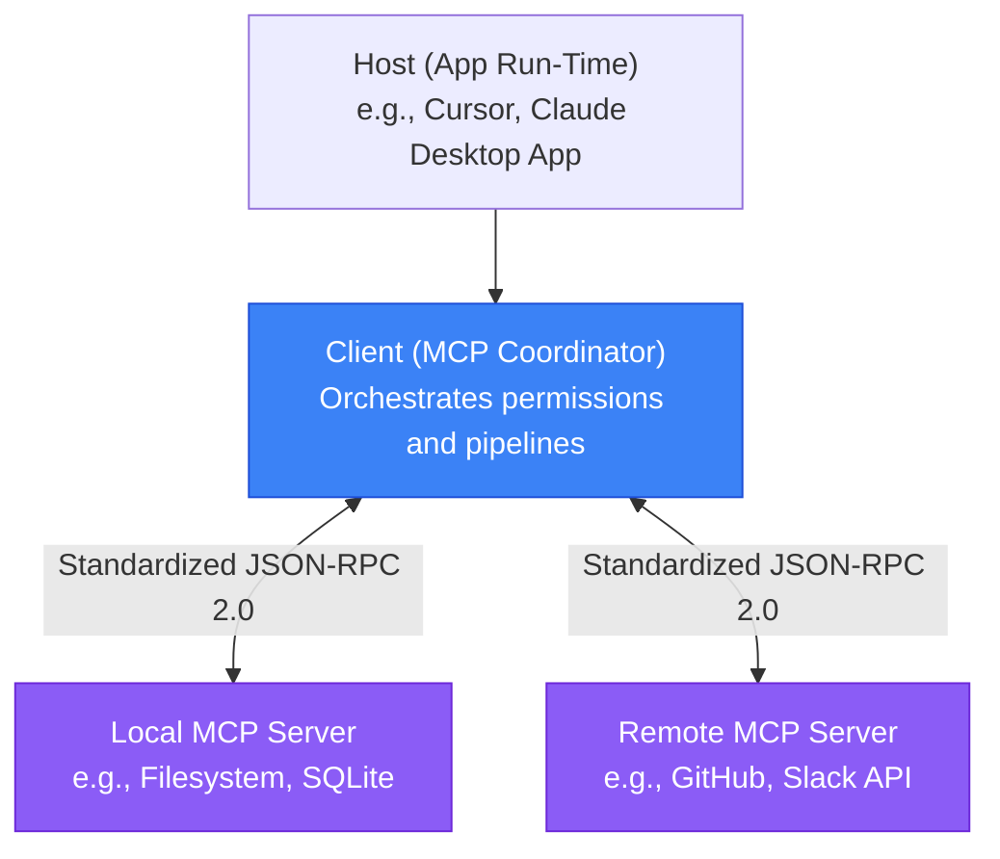
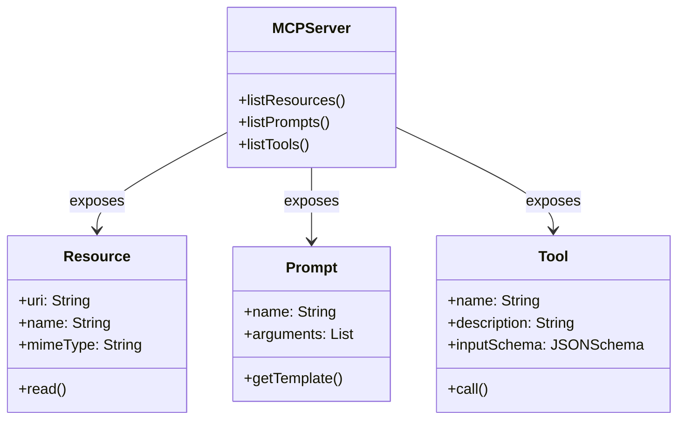

# Model Context Protocol (MCP): The Universal Connection Standard for AI

**Module**: Model Context Protocol  
**Status**: 📝 Draft / Part 1 of 3  

---

Integrating Large Language Models (LLMs) into software systems has historically been a fragmented, custom-coding nightmare. Every time a developer wanted to build an AI assistant that could read a database, query a private search index, or edit local files, they had to write bespoke integration code:

```
[Claude Client]    --> Custom REST API    --> Database
[Cursor Client]    --> Custom Node script --> Local File System
[ChatGPT Client]   --> Custom Action      --> Jira API
```

This lack of standardization led to massive code duplication, high security risks, and brittle integrations that broke whenever an API schema changed.

The **Model Context Protocol (MCP)**, open-sourced by Anthropic, solves this problem by defining a universal, open standard for connecting AI clients to external systems. Think of it as the USB-C standard for the AI era: a single protocol that allows any LLM application to interact with any database, browser, or local runtime securely.

In this first part of our series, we will break down the core architecture of the MCP protocol, its primary capabilities, and the three functional primitives that define its behavior.

---

## 🏗️ The Client-Host-Server Architecture

MCP operates on a simple, modular architecture comprising three distinct roles: the **Client**, the **Host**, and the **Server**.



1.  **The Host**: The user-facing application where the AI experience is running (e.g., Cursor, Claude Desktop, or a custom web app). The Host acts as the orchestrator and security supervisor.
2.  **The Client**: A component inside the host application that manages connections, handles authorization, and communicates with MCP servers. The Client receives the LLM's intent and translates it into protocol requests.
3.  **The Server**: A modular data or tool provider. The Server implements the MCP specification, exposing specific files, API integrations, or local code execution runtimes to the Client.

### Transport Protocols
MCP communicates using **JSON-RPC 2.0**. Depending on where the Server is running, MCP supports two primary transport layers:
*   **Stdio Pipe**: Used for local servers. The Client launches the Server as a subprocess and communicates directly via standard input and output (`stdin`/`stdout`). This offers maximum speed and local isolation.
*   **WebSockets / SSE (Server-Sent Events)**: Used for remote servers running in the cloud or across a local network.

---

## 🧩 The Three Primitives of MCP

At its functional core, MCP provides three primary primitives that define what a server can expose to the AI client: **Resources**, **Prompts**, and **Tools**.



### 1. Resources (Read-Only Data)
Resources are read-only data sources that the AI can inspect to gain context. They function similarly to files or database tables and are identified by a unique **Uniform Resource Identifier (URI)** schema (e.g., `sqlite://db/users` or `file:///var/log/app.log`).
*   **Capabilities**: The server lists available resources, and the client can read their contents. Resources can represent static text (markdown readmes), raw binary data (PDF manuals), or dynamic real-time streams (console logs).
*   **Use Case**: Exposing a project's documentation file directly into Cursor's context window.

### 2. Prompts (Standardized Templates)
Prompts are pre-defined templates or instructions that help the AI perform specific tasks. They simplify complex workflows by structuring the user's input before it reaches the LLM.
*   **Capabilities**: The server can expose a list of prompts. The client can request a specific prompt template, pass arguments to it, and receive a structured prompt message that is appended to the conversation context.
*   **Use Case**: A `code-review` prompt that accepts a filename and returns a template instructing the model to analyze that file for security vulnerability patterns.

### 3. Tools (Executable Actions)
Tools are executable actions that allow the AI to actively modify systems or interact with the external world. They are the most powerful part of the protocol, turning passive conversational models into active agents.
*   **Capabilities**: Tools are defined with a semantic name, a human-readable description (which the LLM reads to know *when* to use it), and a strict **JSON Schema** defining the required input arguments. When the LLM decides to call a tool, the Client executes it on the Server and returns the output to the LLM.
*   **Use Case**: A `run_command` tool that runs test scripts on the local terminal, or a `create_issue` tool that sends an API request to GitHub.

---

## 🔒 Security and Isolation

MCP was designed with strict security isolation in mind. Because the Server operates as a separate process or external service, the AI client does not have raw, direct access to your system.
*   **Strict Encapsulation**: The LLM can only query resources or trigger tools that have been explicitly exposed by the Server configuration. If the Server does not declare a `delete_file` tool, the agent has zero capacity to delete files, regardless of any prompt injection attempts.
*   **User Confirmation**: Modern hosts (like Cursor) require explicit user consent before executing any tool that could modify state (e.g., running shell commands or sending web requests).

---

## 🔗 What’s Next?
Now that we understand the baseline client-host-server architecture and the three core primitives, we can explore how this standard scales to the cloud. 

In [Part 2: MCP v2 — Decoupling State for Cloud-Native Scales](file:///Users/maxtomasello/git/own/content-creation/software-engineering/agentic-ai-hub/blog/07-model-context-protocol/02-mcp-v2-the-stateless-revolution.md), we will examine how the protocol transitioned from a stateful, local standard to a stateless edge infrastructure built for enterprise applications.

---
*Generated as part of the [Agentic AI Hub](file:///Users/maxtomasello/git/own/content-creation/software-engineering/agentic-ai-hub/README.md) blueprint.*