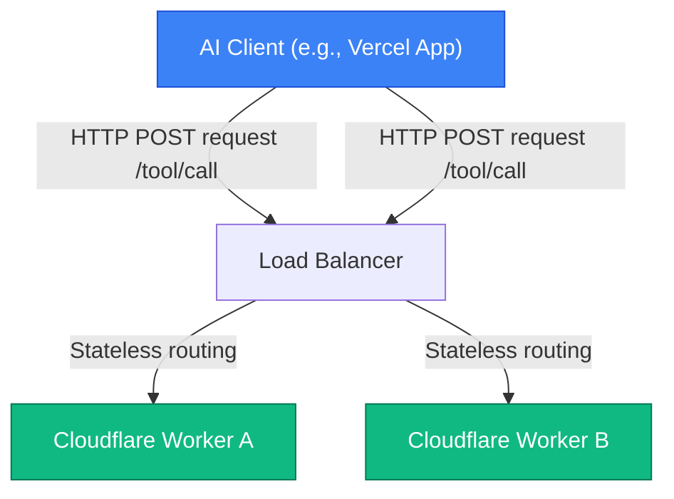

# MCP v2: Decoupling State for Cloud-Native AI Scales

**Module**: Model Context Protocol  
**Status**: 📝 Draft / Part 2 of 3  

---

In [Part 1: The Universal Connection Standard](file:///Users/maxtomasello/git/own/content-creation/software-engineering/agentic-ai-hub/blog/07-model-context-protocol/01-introduction-to-model-context-protocol.md), we established the foundational architecture of the Model Context Protocol (MCP) and how it uses Resources, Prompts, and Tools to connect AI clients to local or remote servers. 

However, as developers began deploying MCP in production, a major engineering bottleneck emerged. The initial protocol specification (v1) was designed around **stateful, session-based connections**. 

In this article, we will examine the architectural limitations of stateful AI protocols and explore how the **MCP v2 specification (released on July 28, 2026)** decoupled state to enable cloud-native, serverless scaling.

---

## 🛑 The Stateful Bottleneck in v1

The v1 specification was designed primarily for local-first execution. AI clients (like Cursor or Claude Desktop) connect to local MCP servers via standard input/output (`stdio`) pipes or local WebSockets. These connections are persistent and stateful: the server maintains an active memory of the active session, tracking connection state, active tool definitions, and resource registrations over time.

While excellent for a developer running Cursor on their laptop, this session-oriented model breaks down completely when scaling to enterprise cloud applications:
1.  **Server Exhaustion**: Keeping WebSockets or Server-Sent Events (SSE) active for thousands of concurrent users requires massive memory and open port overhead.
2.  **No Serverless Compatibility**: Modern serverless runtimes (like Cloudflare Workers, Vercel Edge, or AWS Lambda) are designed to execute quickly and shut down. They cannot maintain persistent, stateful connections, rendering them incompatible with v1 MCP.
3.  **Complex Load Balancing**: Stateful servers require "sticky sessions" to ensure that an AI client's subsequent tool requests route back to the exact same server instance that holds the connection state. This makes horizontal scaling complex and fragile.

---

## ⚡ The Stateless Core of MCP v2

To solve these scalability challenges, the **2026-07-28 (v2) specification** overhauled the core communication engine, shifting MCP from a stateful session-oriented protocol to a **stateless request/response model**.

In MCP v2, the server no longer maintains an active connection state. Instead:
*   **Encapsulated Transactions**: Each tool invocation or resource request is processed as a standalone, stateless transaction. All necessary context (including authorization tokens and configuration parameters) is passed in the request header or body.
*   **HTTP Native**: While stdio is still supported for local developer workflows, cloud connections migrate to standard HTTP POST endpoints. This allows standard load balancers to route requests to any available container or worker instance, simplifying horizontal scaling.
*   **Edge & Serverless Deployment**: Developers can now write MCP servers and deploy them directly on edge platforms. An MCP server running on Cloudflare Workers starts in milliseconds, processes a tool execution, and terminates immediately, reducing infrastructure costs to near-zero.

---

## 🛡️ Enterprise Security: OAuth 2.1 & OIDC Alignment

Stateful connections are notoriously difficult to secure because once a WebSocket is opened, it is assumed to be authorized for the duration of the session. 

MCP v2 addresses this by aligning the protocol directly with modern B2B security standards:
*   **Per-Request Authorization**: Every stateless request carries an authorization header (OAuth 2.1 or OpenID Connect JSON Web Token).
*   **Granular Scopes**: The token defines exactly what scopes the AI client is permitted to invoke (e.g., `mcp:tools:read`, `mcp:resources:write`).
*   **Token Propagation**: If an agent needs to execute a tool on an enterprise API, the client propagates the user's secure JWT directly to the MCP server. The server verifies the token against the enterprise Identity Provider (IdP) before executing the database query or API call, ensuring the agent never accesses data the user is unauthorized to see.

---

## 🧩 The Extensions Framework: MCP Apps & Tasks

Moving to a stateless core meant that long-running operations could no longer hold a connection open. To handle complex agentic workflows, MCP v2 introduced the **Extensions Framework**:

### 1. Asynchronous Tasks
If an agent triggers a tool that takes several minutes (e.g., compiling a large codebase or running a machine learning backtest), the stateless server immediately returns a `Task ID` with a `202 Accepted` status. 
The client then polls a status endpoint or listens for a stateless webhook event to receive the execution output when complete, preventing timeout issues.

### 2. Interactive MCP Apps
The v2 specification allows servers to register **MCP Apps**. This enables the server to return structured visual components (like custom HTML/JS forms, interactive charts, or approval buttons) directly to the AI client's user interface. The user can interact with the app locally, and the client sends the resulting data back to the server in a stateless post transaction.

---

## 🔗 Moving to Implementation
Decoupling state makes MCP v2 highly scalable, secure, and ready for production enterprise architectures. But how do we build one safely?

In [Part 3: Enterprise Safety — Connecting Agents to GraphQL with Apollo MCP Server](file:///Users/maxtomasello/git/own/content-creation/software-engineering/agentic-ai-hub/blog/07-model-context-protocol/03-case-study-apollo-graphql-mcp-server.md), we will walk through a concrete case study, demonstrating how to use the Apollo GraphQL MCP Server to expose structured schemas to AI agents safely.

---
*Generated as part of the [Agentic AI Hub](file:///Users/maxtomasello/git/own/content-creation/software-engineering/agentic-ai-hub/README.md) blueprint.*
