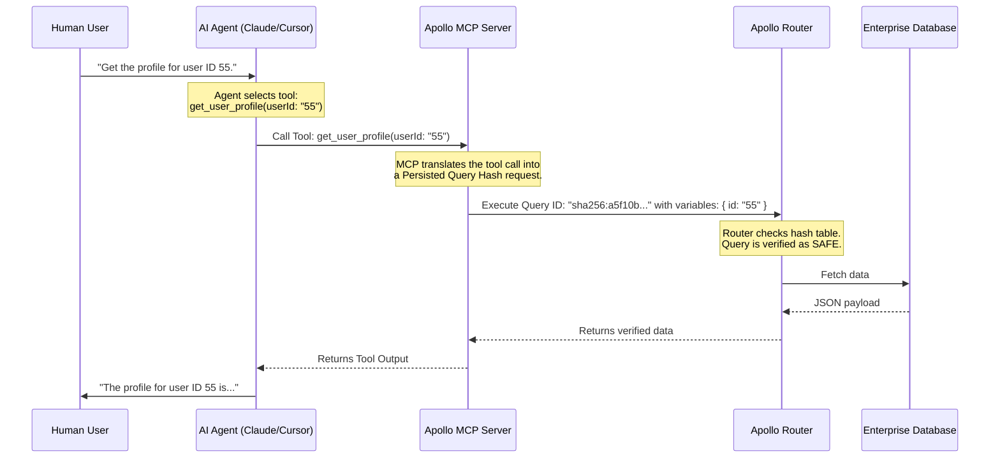

# Enterprise Safety: Connecting Agents to GraphQL with Apollo MCP Server

**Module**: Model Context Protocol  
**Status**: 📝 Draft / Part 3 of 3  

---

In [Part 2: The Stateless Revolution](file:///Users/maxtomasello/git/own/content-creation/software-engineering/agentic-ai-hub/blog/07-model-context-protocol/02-mcp-v2-the-stateless-revolution.md), we analyzed how the Model Context Protocol (MCP) v2 specification decoupled state to enable secure, edge-scalable enterprise integrations. 

However, exposing raw enterprise databases or APIs to autonomous AI agents poses severe security risks. A prompt injection attack could trick the agent into executing destructive operations, bypassing validation rules, or scraping sensitive data.

In this third and final part of our series, we will examine a concrete case study of enterprise-grade integration: the **Apollo GraphQL MCP Server**. We will explore why GraphQL is a natural partner for AI and demonstrate how to expose data to agents safely using **Persisted Queries**.

---

## 🤝 Why GraphQL is Built for AI Agents

When connecting an LLM to a REST API or a relational database, you must write extensive semantic descriptions so the agent understands how to map fields, resolve dependencies, and query parameters.

**GraphQL** simplifies this because it is **strongly typed and self-documenting**. 
*   **Introspection**: A GraphQL schema provides a single source of truth describing all available entities, queries (read actions), and mutations (write actions).
*   **Predictable Graph Structure**: AI agents excel at traversing graphs. In GraphQL, related entities (e.g., a `User` and their `Orders`) are linked. The agent can request exactly what it needs in a single request, preventing over-fetching and reducing token overhead.
*   **Validation**: The GraphQL engine validates all query structures and types before execution, acting as a built-in firewall against malformed inputs.

---

## 🛡️ Production Safety: Persisted Queries

Exposing a raw GraphQL endpoint directly to an LLM is a major security vulnerability. A hijacked agent could execute a query like:

```graphql
# Dangerous ad-hoc query injected via prompt injection
query MaliciousQuery {
  users {
    socialSecurityNumber
    creditCardInfo
  }
}
```

To prevent this, the **Apollo GraphQL MCP Server** uses **Persisted Queries (PQs)**. 

Instead of allowing the AI agent to write and execute arbitrary GraphQL queries, the developer pre-compiles a set of safe queries. These queries are registered on the Apollo Router and identified by a unique SHA-256 hash. The client can only execute queries that match this hash.



If a prompt injection attempts to force the agent to run an unauthorized query, the Apollo Router immediately rejects the execution because the query's hash does not exist in the pre-approved whitelist.

---

## 💻 Code Walkthrough: Building a Secure GraphQL MCP Server

Here is how you can set up a secure, stateless Apollo MCP Server using the TypeScript SDK v2 to expose a persisted query tool to your AI agents:

```typescript
import { McpServer } from "@modelcontextprotocol/sdk"; // SDK v2
import { ApolloClient, InMemoryCache, HttpLink, gql } from "@apollo/client/core";

// 1. Initialize the stateless MCP Server
const mcpServer = new McpServer({
  name: "apollo-enterprise-gateway",
  version: "2.0.0"
});

// 2. Initialize Apollo Client to talk to your Apollo Router
const apolloClient = new ApolloClient({
  link: new HttpLink({
    uri: "https://api.mycompany.com/graphql",
    headers: {
      "X-Apollo-Operation-Name": "GetClientContactInfo"
    }
  }),
  cache: new InMemoryCache()
});

// 3. Define and register the tool, backing it with a Persisted Query
mcpServer.tool(
  "get_client_contact",
  "Retrieves safe, pre-vetted contact details for a client using their ID.",
  {
    clientId: { type: "string", description: "The unique client ID string" }
  },
  async ({ clientId }, extraContext) => {
    // Propagate the user's OAuth 2.1 authentication token passed from the MCP Client
    const userAuthToken = extraContext.request.headers["authorization"];

    try {
      // Execute query via Apollo Client using its Persisted Query configuration
      const response = await apolloClient.query({
        query: gql`
          query GetClientContactInfo($id: ID!) {
            client(id: $id) {
              name
              email
              status
            }
          }
        `,
        variables: { id: clientId },
        context: {
          headers: {
            Authorization: userAuthToken // Secure token propagation
          },
          // Force Apollo to use the pre-registered Persisted Query Hash
          http: {
            includeExtensions: true,
            includeQuery: false // Do NOT send the raw query text over the wire
          }
        }
      });

      return {
        content: [{ type: "text", text: JSON.stringify(response.data.client) }]
      };
    } catch (error) {
      return {
        isError: true,
        content: [{ type: "text", text: `Authorization or query failed: ${error}` }]
      };
    }
  }
);

// Start the server (e.g., using stdio transport for local integration)
import { StdioServerTransport } from "@modelcontextprotocol/sdk/dist/esm/transport/stdio.js";
const transport = new StdioServerTransport();
mcpServer.connect(transport);
console.error("Apollo MCP Server connected over stdio!");
```

---

## 🎯 Conclusion

Exposing backend systems to AI agents does not have to be a choice between capability and security. 

By wrapping your enterprise data in a strongly typed **GraphQL Schema**, exposing operations through the **Apollo MCP Server**, and enforcing **Persisted Queries** and **OAuth 2.1 Token Propagation**, you create a secure playground for autonomous agents. This architecture provides the structural security net required to deploy Agentic AI systems safely in production.

---
*Generated as part of the [Agentic AI Hub](file:///Users/maxtomasello/git/own/content-creation/software-engineering/agentic-ai-hub/README.md) blueprint.*
