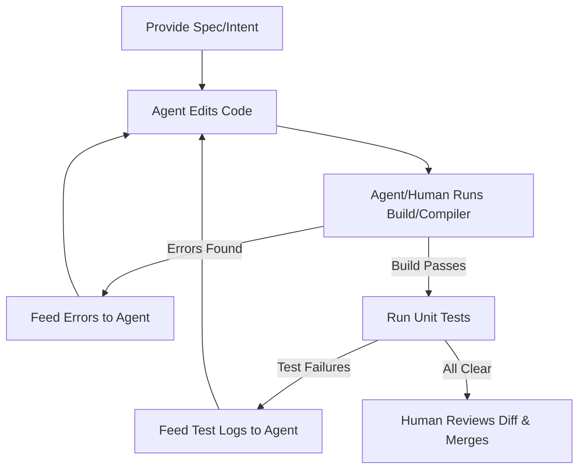

# Module 4: Writing Code for and with AI

## 📌 Introduction
When humans write code, we optimize for human readability: formatting, naming conventions, indentation, and structure. 

In the AI-Native era, we must optimize codebases for a dual audience: **human engineers and AI agents**. A codebase that is easy for an AI to read, navigate, and compile is a codebase where AI can work at 10x velocity with 0% error rates. 

This module details how to design systems for AI consumption and how to establish an effective collaborative coding loop with agents.

---

## 🔑 Key Concepts

### 1. Codebase Ergonomics for AI Agents
To make your codebase "AI-friendly," implement these three structural design principles:

#### 🟢 Rule A: Strict, Static Typing
AI excels when there is a deterministic schema. 
*   **Weak/Dynamic (JS, Python without types)**: The AI has to guess the shape of objects passing through functions. It frequently hallucinates properties or methods.
*   **Strong/Static (TypeScript, Go, Rust, Java)**: The compiler acts as an automated judge. If the AI writes a bug, the compiler immediately rejects it with a specific line number and error message, allowing the AI to auto-correct.
*   *Action*: Enforce strict type checking (`tsconfig.json` strict settings, Python type hints, Go structs).

#### 🟢 Rule B: Modular & Decoupled Files (No "God Files")
If a file contains 3,000 lines of code, an AI will struggle to digest it, make errors, and likely hit context limitations.
*   *Action*: Break code into single-responsibility modules. Keep files under 250-300 lines where possible. Smaller files are cheaper to process, faster to edit, and have lower chances of regression.

#### 🟢 Rule C: Self-Documenting Interfaces and JSDoc/Docstrings
AI reads documentation in real-time. Adding concise docstrings with param/return types helps the AI understand a function's intent without reading the implementation.

---

## ⚙️ IDE Configuration Files: Guiding the Agent
You can program your IDE's AI behavior using configuration rules (e.g., `.cursorrules`, `.copilot-instructions`). These files tell the AI how to behave, what code patterns to use, and what styles to enforce.

### Example `.cursorrules` Structure:
```markdown
# Front-end Rules
- Use TypeScript for all UI code. No `any` type allowed.
- Use functional components and React Hooks.
- Style components using Vanilla CSS utility classes or custom variables; do not import external CSS libraries.

# Code Generation Rules
- Never delete existing comments or docstrings unless requested.
- Always check compile errors before completing your turn.
- Write modular, testable code.
```

---

## 🔄 The Collaborative Loop: The Compile-Fix Cycle
When working with Level 3 Agents, developers often make the mistake of just watching the agent fail. Instead, guide the agent through the **Compile-Fix Cycle**:



By leveraging the compiler and linting tools as the feedback loop, the agent acts as a self-correcting machine.

---

## 🧠 Classroom Discussion / Exercise
1.  **Refactor challenge**: Take a large, dynamically-typed file (e.g., a vanilla JavaScript helper module) and refactor it into smaller, statically-typed TypeScript modules. Observe how the AI's ability to help you write code *for* that module increases.
2.  **Evaluating Diffs**: How do you review a 5-file diff generated by an AI in 30 seconds? What are your look-outs (e.g., security flaws, hidden resource leaks, missing edge cases)?

---

## 📖 Recommended Reading & Resources
*   *Clean Architecture in the AI Era: Designing Clean Boundaries for Generative Agents*
*   *TypeScript: The AI Developer's Best Friend*

---
[Back to Curriculum](file:///Users/maxtomasello/git/own/software-engineering/courses/ai-native-sdlc/curriculum.md) | [Next Module: AI-Native Testing & Verification](file:///Users/maxtomasello/git/own/software-engineering/courses/ai-native-sdlc/modules/module-5-verification.md)
