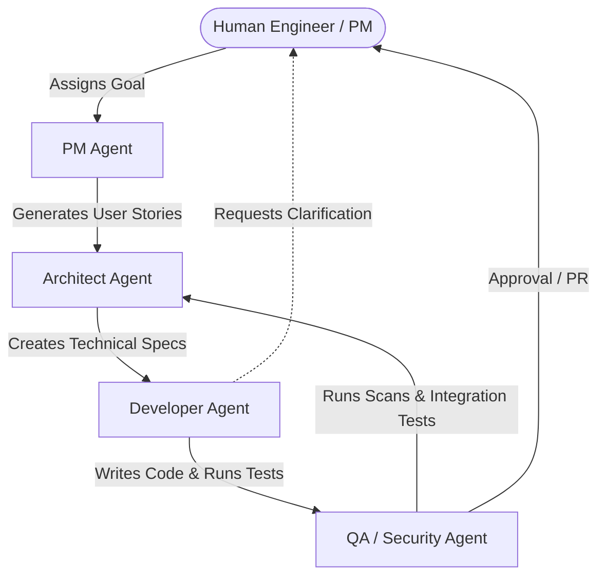

# Module 6: The Future: Multi-Agent Teams & Systems

## 📌 Introduction
Using a single AI assistant in an IDE is just the beginning. The next frontier in the evolution of the SDLC is the transition to **Multi-Agent Systems (MAS)**.

Instead of a single developer interacting with a chatbot, software engineering departments are adopting virtual "agile teams" composed of specialized, autonomous AI agents. These agents communicate with each other, execute tasks in parallel, and seek human feedback only at critical checkpoints.

This module details how multi-agent teams operate and how human engineers must prepare to orchestrate them.

---

## 🔑 Key Concepts

### 1. The Structure of a Virtual AI Agile Team
In a multi-agent software team, agents are assigned distinct roles with specialized prompts, system boundaries, and tools:

#### 🎭 Agent Roles:
*   **The Product Manager Agent**: Translates high-level user requests into granular user stories, acceptance criteria, and edge-case definitions.
*   **The System Architect Agent**: Analyzes the existing database schemas, API structures, and file systems. It designs the implementation blueprint and writes the Markdown specifications.
*   **The Developer Agent**: Reads the specifications, navigates the directories, modifies code files, handles dependencies, and fixes compilation errors.
*   **The QA & Security Agent**: Scans the developer's output for security vulnerabilities (e.g., SQL injection, exposed secrets), checks test coverage, and writes automated test cases.

---

## 👥 The Human's New Role: Director of Engineering
In a multi-agent system, the human's role shifts from writing code to managing the agent workforce:

1.  **Goal Setter**: Defining clear business objectives and product vision.
2.  **Reviewer & Gatekeeper**: Auditing proposed architectures, reviewing code diffs, and verifying staging deployments.
3.  **Ambiguity Resolver**: Answering clarifying questions when agents hit blockers (e.g., *"Should user data be soft-deleted or hard-deleted in the database?"*).
4.  **Systems Thinker**: Guiding the broad architecture of the software, choosing third-party platforms, and ensuring long-term product viability.

---

## 🚀 The Skills That Matter in 2026 and Beyond
As writing code becomes commoditized, human engineers must double down on these core competencies:

*   **Systems Design & Architecture**: Understanding distributed systems, database scaling, caching, network topologies, and modular clean architecture.
*   **Domain Expertise**: Deeply understanding the industry (e.g., FinTech regulations, healthcare data standards, gaming mechanics) to design correct business logic.
*   **Rigor & Verification**: Knowing how to test software, write robust test cases, and identify subtle concurrency bugs, race conditions, or security exploits.
*   **Agent Orchestration**: Mastering prompt patterns, writing customized rulesets (`.cursorrules`), and designing robust pipelines.

---

## 🧠 Classroom Discussion / Exercise
1.  **Team Dynamics**: If you had a team of 10 virtual developers that could code 24/7, how would you change your development process? What bottlenecks would move to the human (e.g., code review speed, product definition)?
2.  **The Shift in Education**: If code syntax is no longer the primary skill, how should universities and bootcamps teach software engineering to beginners?

---

## 📖 Recommended Reading & Resources
*   *Orchestrating Agents: Design Patterns for Multi-Agent Software Engineering*
*   *The Rise of the Human Architect: Career Guidance for the Next Generation of Engineers*

---
[Back to Curriculum](file:///Users/maxtomasello/git/own/software-engineering/courses/ai-native-sdlc/curriculum.md)
