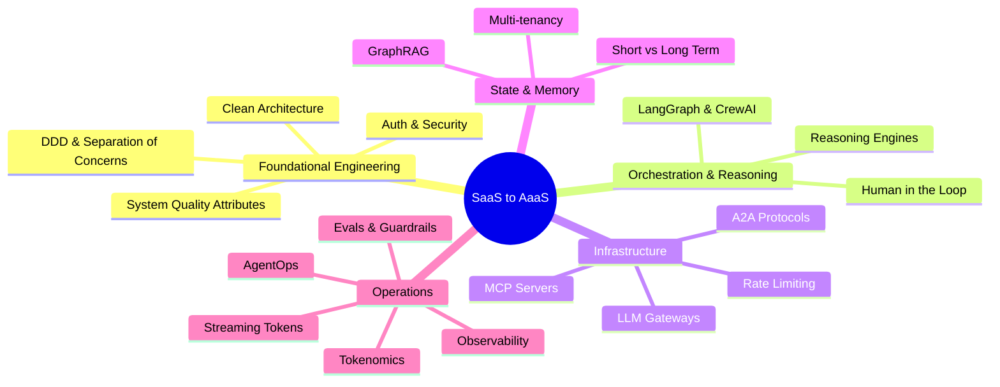

# Course Syllabus: Transforming SaaS into AaaS (Agents as a Service)

This is the main syllabus and navigation index for the SaaS-to-AaaS course, detailing how to engineer stateful, multi-tenant agentic platforms on top of standard SaaS software patterns.

---

## 🗺️ Topic Map Overview

---

## 📚 Course Chapters

| Chapter | Title | Focus Areas | Guide Link |
| :--- | :--- | :--- | :--- |
| **Chapter 1** | **Foundational Software Engineering** | Auth boundaries, DDD, Clean Architecture, System -ilities | [Chapter 1 Guide](file:///Users/maxtomasello/git/own/software-engineering/courses/saas-to-aaas/content/1-foundational-engineering/index.md) |
| **Chapter 2** | **Orchestration & Reasoning** | ReAct loops, LangGraph, CrewAI, HITL, execution patterns | [Chapter 2 Guide](file:///Users/maxtomasello/git/own/software-engineering/courses/saas-to-aaas/content/2-orchestration-reasoning/index.md) |
| **Chapter 3** | **Infrastructure & Integration** | MCP, LLM gateways (LiteLLM), internal APIs, Rate Limiting | [Chapter 3 Guide](file:///Users/maxtomasello/git/own/software-engineering/courses/saas-to-aaas/content/3-infrastructure-integration/index.md) |
| **Chapter 4** | **State & Memory Systems** | Short & long-term memory, Multi-tenant isolation | [Chapter 4 Guide](file:///Users/maxtomasello/git/own/software-engineering/courses/saas-to-aaas/content/4-state-memory/index.md) |
| **Chapter 5** | **Knowledge Retrieval** | GraphRAG, Vector RAG pipelines, help center integrations | [Chapter 5 Guide](file:///Users/maxtomasello/git/own/software-engineering/courses/saas-to-aaas/content/5-knowledge-retrieval/index.md) |
| **Chapter 6** | **Operations, Security & Tokenomics** | Evals, Guardrails, Observability, AgentOps, billing plans | [Chapter 6 Guide](file:///Users/maxtomasello/git/own/software-engineering/courses/saas-to-aaas/content/6-operations-security-tokenomics/index.md) |

---

## 📖 Global References
*   [Course Reference Library](file:///Users/maxtomasello/git/own/software-engineering/courses/saas-to-aaas/references/README.md) — Research papers and technical reading list.
