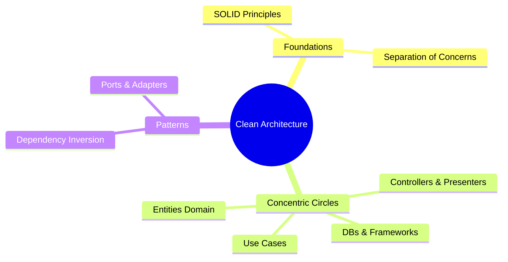

# Course Syllabus: Clean Architecture

This course covers architectural separation of concerns, focusing on Robert C. Martin's Clean Architecture, Hexagonal Architecture, and the SOLID design principles to build codebase models that remain independent of external frameworks, databases, and user interfaces.

---

## 🗺️ Topic Map Overview

---

## 📁 Curriculum Modules

### Module 1: Architectural Foundations
*   **The SOLID Principles**: Single Responsibility, Open-Closed, Liskov Substitution, Interface Segregation, and Dependency Inversion.
*   **Separation of Concerns**: Establishing clear boundaries between business rules, user interfaces, data access, and communication layers.
*   **The Dependency Rule**: Source code dependencies must point inward, toward the core business rules. Outer circles (e.g. database, web frameworks) must not affect inner circles (e.g. use cases, entities).

### Module 2: concentric Layers
*   **Entities (Enterprise Business Rules)**: Encapsulating the most general and high-level business rules (independent of application workflows).
*   **Use Cases (Application Business Rules)**: Orchestrating the flow of data to and from entities, executing core workflows.
*   **Interface Adapters (Controllers, Gateways, Presenters)**: Converting data from the format most convenient for use cases into the format most convenient for external agencies (UI, DB).
*   **Frameworks & Drivers**: Databases, web frameworks, email services, and UI rendering layers (kept at the outermost layer).

### Module 3: Decoupling & Testability
*   **Ports & Adapters (Hexagonal)**: Creating abstract interfaces (Ports) and concrete implementations (Adapters) to inject dependencies dynamically.
*   **Testability**: Writing unit tests for the core business logic (Use Cases & Entities) without mocking databases, web servers, or network APIs.
