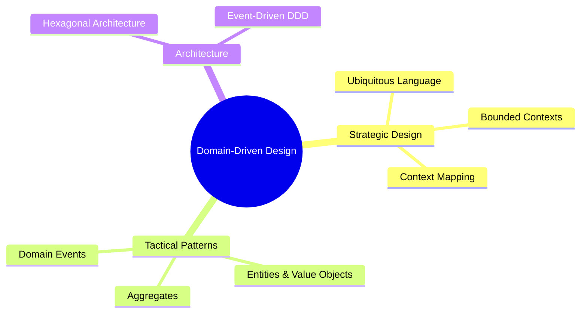

# Course Syllabus: Domain-Driven Design (DDD)

This course covers strategic and tactical Domain-Driven Design patterns to help engineers design complex software systems that reflect business domain realities.

---

## 🗺️ Topic Map Overview

---

## 📁 Curriculum Modules

### Module 1: Strategic Design & Bounded Contexts
*   **Ubiquitous Language**: Creating a shared, rigorous vocabulary between domain experts and software developers.
*   **Bounded Contexts**: Defining semantic boundaries where terms and models have specific, singular meanings.
*   **Context Mapping**: Mapping relationships and data integrations between different Bounded Contexts (Shared Kernel, Customer-Supplier, Conformist, Anti-Corruption Layer).

### Module 2: Tactical Patterns (The Building Blocks)
*   **Entities**: Domain objects defined by a unique identity that persists across state changes.
*   **Value Objects**: Immutable objects defined strictly by their attributes, with no identity (e.g., Money, Address).
*   **Aggregates & Roots**: Defining clusters of associated objects that are treated as a single unit for data changes, controlled strictly through the Aggregate Root.
*   **Repositories & Factories**: abstracting data storage and lifecycle instantiation of Aggregates.

### Module 3: Event-Driven DDD
*   **Domain Events**: Capturing occurrences in the domain that domain experts care about (e.g., `OrderPlaced`, `PaymentProcessed`).
*   **Event Sourcing**: Storing the state of an aggregate as a sequence of historical events rather than just its current state.
*   **CQRS (Command Query Responsibility Segregation)**: Segregating the read model (queries) from the write model (commands) for optimized scaling.
