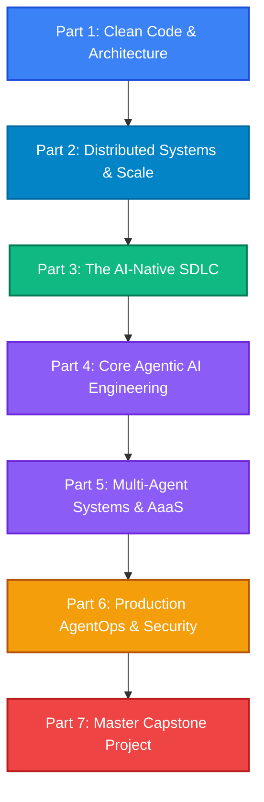

# Master Course Curriculum: The Modern Software Architect

> **Sub-title**: *From Clean Architecture & Systems Design to Agentic AI & The AI-Native SDLC*  
> **Course Format**: Comprehensive Masterclass (Self-Paced Video / Cohort / In-Person Bootcamp)  
> **Track**: Software Engineering (Track A - Authority)

---

## 🎯 Course Overview & Vision

Modern software engineering is undergoing the largest architectural shift since the invention of the internet. Developers can no longer afford to merely type syntax or work in isolated code silos. 

This master curriculum connects the two most critical dimensions of modern software development:
1. **Classical Software Architecture**: Clean Architecture, Domain-Driven Design (DDD), Microservices, and Systems Design—the foundational patterns required to build modular, decoupled, and maintainable systems.
2. **The Agentic & AI-Native Paradigm**: Spec-driven engineering, Model Context Protocol (MCP), ReAct loops, multi-agent orchestration (LangGraph, CrewAI), self-healing test pipelines, and transforming SaaS products into autonomous "Agents-as-a-Service" (AaaS).

Without sound architectural boundaries, AI coding agents generate unmaintainable legacy code at exponential speeds. This course teaches how to architect robust software systems designed from day one to be developed, operated, and scaled alongside autonomous AI agents.

---

## 👥 Target Audience & Prerequisites

* **Target Audience**:
  * **Software Engineers & Senior Developers** transitioning from manual coding to system architecture and agent orchestration.
  * **Tech Leads & Software Architects** establishing development standards, developer tooling, and AI-native pipelines.
  * **Founders & Technical Product Managers** building next-generation agentic platforms (AaaS) and AI-augmented software products.
* **Prerequisites**:
  * Solid working knowledge of at least one backend or full-stack language (Python, TypeScript/JavaScript, Go, Java, or C#).
  * Fundamental understanding of web architecture, databases, and Git.

---

## 🗺️ Curriculum Structure Overview

---

## 📚 Detailed Syllabus

### 🏛️ Part 1: Clean Code & Architectural Foundations
*Building modular, decoupled, and testable domain logic that humans and AI agents can navigate seamlessly.*

#### Section 1: Course Orientation & The Modern Engineering Landscape
* **1.1 The Shift**: From Monoliths to Microservices to Agentic Workflows.
* **1.2 Why Architecture Matters More Than Ever**: How spaghetti code degrades AI coding agent performance.
* **1.3 Environment Setup**: Tooling, IDEs (Cursor/Windsurf), linting, and project conventions.

#### Section 2: Clean & Hexagonal Architecture
* **2.1 The SOLID Principles**: Practical modern interpretation without dogma.
* **2.2 The Dependency Inversion Principle**: Structuring concentric architectural circles.
* **2.3 Core Domain vs. Infrastructure**: Entities, Use Cases, Interface Adapters, and Framework drivers.
* **2.4 Ports & Adapters Pattern**: Implementing dynamic dependency injection and decoupling databases/frameworks.
* **2.5 Automated Verification**: Writing pure unit tests for domain logic without mocks or live databases.

#### Section 3: Strategic & Tactical Domain-Driven Design (DDD)
* **3.1 Ubiquitous Language**: Bridging business domain models, technical code, and prompt contexts.
* **3.2 Bounded Contexts & Context Mapping**: Shared Kernels, Customer-Supplier, and Anti-Corruption Layers (ACL).
* **3.3 Tactical Building Blocks**: Entities, Value Objects, and Aggregate Roots.
* **3.4 Domain Events**: Decoupling side effects and state transitions across domain boundaries.
* **3.5 Introduction to Event Sourcing & CQRS**: Segregating read and write models for high throughput.

---

### 🌐 Part 2: Distributed Systems, APIs & Scalability
*Connecting microservices and scaling systems for high reliability.*

#### Section 4: API-First Delivery & Integration Standards
* **4.1 Contract-First Development**: Designing OpenAPI / Swagger specifications before writing code.
* **4.2 Protocol Trade-offs**: REST vs. gRPC vs. GraphQL for internal and external communication.
* **4.3 Resilient API Gateways**: Rate limiting, authentication boundaries, and backward compatibility.

#### Section 5: Microservices Architecture
* **5.1 Deconstructing the Monolith**: Applying the Strangler Fig Pattern in practice.
* **5.2 The Database-per-Service Pattern**: Managing data isolation without distributed deadlocks.
* **5.3 Asynchronous Event Choreography**: Event brokers (Kafka / RabbitMQ) vs. synchronous HTTP.
* **5.4 Distributed Transactions**: Implementing the Saga Pattern (Choreography vs. Orchestration) with compensating transactions.
* **5.5 Resiliency & Distributed Tracing**: Circuit Breakers, Bulkheads, OpenTelemetry, and Jaeger.

#### Section 6: High-Scale Systems Design
* **6.1 Scaling Paradigms**: Vertical vs. Horizontal scaling and Layer 4/Layer 7 Load Balancing.
* **6.2 Multi-Tier Caching**: Browser, CDN, Redis/Memcached, write-through vs. read-through patterns.
* **6.3 Distributed Data Stores**: SQL vs. NoSQL, horizontal database sharding, and consistent hashing.
* **6.4 CAP & PACELC Theorems**: Practical tradeoffs between Consistency, Availability, and Latency.
* **6.5 Backpressure & Rate Limiting**: Token Bucket, Leaky Bucket, and Sliding Window algorithms.

---

### ⚡ Part 3: The AI-Native SDLC (Modern Developer Workflows)
*How high-velocity engineers design, build, and verify software using autonomous tools.*

#### Section 7: The Shift from Syntax to Architecture
* **7.1 Deconstructing SDLC Bottlenecks**: Why typing syntax is no longer the rate-limiting step.
* **7.2 The AI Developer Toolbelt**: Cursor, Windsurf, Copilots, custom CLI skills, and IDE rules.
* **7.3 Codebase Ergonomics for AI**: Repository maps, documentation conventions, and `.cursorrules` configuration.

#### Section 8: Spec-Driven Development & Prompt Architecture
* **8.1 Writing Specs Over Tickets**: Creating Markdown blueprints and executable feature specifications.
* **8.2 Guiding Multi-File Implementations**: Managing agent context windows across large codebases.
* **8.3 The Compiler Feedback Loop**: Feeding type-checker and linter outputs back into agent context.

#### Section 9: Automated Verification & Self-Healing CI/CD
* **9.1 Strict Type Systems as Agent Guardrails**: Using compilers to validate agent logic deterministically.
* **9.2 Self-Healing Test Loops**: Configuring autonomous agents to fix failing test suites until green.
* **9.3 Continuous Verification**: Automated AI code review bots and pull request validation pipelines.

---

### 🧠 Part 4: Core Agentic AI Engineering
*Engineering single autonomous agents that reason, plan, and execute multi-step tasks.*

#### Section 10: Foundations of Autonomous Agents
* **10.1 Anatomy of an Agent**: Perception, reasoning, planning, memory, and tool actuation.
* **10.2 The ReAct Loop**: Step-by-step trace of Reasoning + Action execution.
* **10.3 Function Calling & Tool Binding**: Validating schemas and handling dynamic tool invocations.

#### Section 11: The Model Context Protocol (MCP)
* **11.1 Understanding MCP**: The open standard for connecting AI models to tools and context.
* **11.2 MCP Topology**: Clients, Hosts, and Servers explained.
* **11.3 Building Custom MCP Servers**: Exposing internal databases, APIs, and file systems safely to agents.

#### Section 12: Memory & State Systems
* **12.1 Context Windows vs. Persistent Memory**: Ephemeral conversation state vs. episodic and semantic storage.
* **12.2 Multi-Tenant Data Isolation**: Securing agent memory across enterprise customer boundaries.
* **12.3 Knowledge Retrieval**: Comparing standard Vector RAG with GraphRAG and Hybrid Search.

---

### 🤝 Part 5: Multi-Agent Systems & Transforming SaaS into AaaS
*Orchestrating agent teams and turning static software into autonomous services.*

#### Section 13: Multi-Agent Orchestration Frameworks
* **13.1 Topologies**: Hierarchical orchestrators vs. peer-to-peer collaborative agent networks.
* **13.2 State Machines with LangGraph**: Cyclic graphs, persistence, and checkpointing.
* **13.3 Role-Based Multi-Agent Teams with CrewAI**: Defining goals, backstories, and task delegations.
* **13.4 Human-in-the-Loop (HITL)**: Approval gates, confidence thresholds, and break-glass workflows.

#### Section 14: Transforming SaaS into AaaS (Agents as a Service)
* **14.1 The Business Model Shift**: Moving from manual UI dashboards to autonomous background outcomes.
* **14.2 LLM Gateway Infrastructure**: Implementing LiteLLM, fallback routing, and token load balancing.
* **14.3 Streaming & Asynchronous Queues**: Managing long-running agent workflows with Celery/Temporal/BullMQ.

---

### 🛡️ Part 6: Production AgentOps, Security & Economics
*Deploying, securing, and maintaining production-grade agentic platforms.*

#### Section 15: AgentOps, Evaluations & Guardrails
* **15.1 Evaluating Non-Deterministic Systems**: Deterministic unit assertions vs. LLM-as-a-Judge evals.
* **15.2 Guardrails & Security**: Mitigating Prompt Injection, Jailbreaks, and unintended tool executions.
* **15.3 Full-Trace Observability**: Distributed tracing for agentic trees using OpenTelemetry and Langfuse/Arize.

#### Section 16: Economics, Governance & Edge Deployment
* **16.1 Tokenomics**: Calculating unit economics, context window caching, and ROI per task.
* **16.2 Data Privacy & Compliance**: GDPR, SOC2, and data isolation in agent ecosystems.
* **16.3 Edge & Local Agent Deployment**: Running Small Language Models (SLMs) locally via Ollama / ONNX.

---

### 🚀 Part 7: The Master Capstone Project
*Synthesizing all concepts into an end-to-end production application.*

#### Section 17: Capstone: The Autonomous Enterprise Operations Platform
* **17.1 Architecture & Domain Modeling**: Defining Bounded Contexts, Aggregates, and Clean Architecture boundaries.
* **17.2 Backend Services & Custom MCP Server**: Implementing core APIs and exposing them via MCP.
* **17.3 Multi-Agent Crew Implementation**: Building the autonomous orchestration loop with LangGraph.
* **17.4 Self-Healing CI/CD & Evals**: Setting up automated verification and safety guardrails.
* **17.5 Production Deployment & Review**: Deploying with token telemetry, tracing, and monitoring.

---

## 🔗 Related Resources in this Repository

* **Foundational Course Modules**:
  * [Clean Architecture Guide](file:///Users/maxtomasello/git/own/content-creation/software-engineering/courses/clean-architecture/content/index.md)
  * [Domain-Driven Design Guide](file:///Users/maxtomasello/git/own/content-creation/software-engineering/courses/ddd/content/index.md)
  * [Microservices Architecture Guide](file:///Users/maxtomasello/git/own/content-creation/software-engineering/courses/microservices/content/index.md)
  * [Systems Design Guide](file:///Users/maxtomasello/git/own/content-creation/software-engineering/courses/systems-design/content/index.md)
* **Agentic Curricula**:
  * [The AI-Native SDLC Curriculum](file:///Users/maxtomasello/git/own/content-creation/software-engineering/courses/agentic-ai/software-development/ai-native-sdlc/curriculum.md)
  * [SaaS to AaaS Syllabus](file:///Users/maxtomasello/git/own/content-creation/software-engineering/courses/agentic-ai/software-products/saas-to-aaas/content/index.md)
  * [The Agentic AI Hub](file:///Users/maxtomasello/git/own/content-creation/software-engineering/agentic-ai-hub/README.md)
* **Funnel & Monetization Strategy**:
  * [AI-Native SDLC Spin-Off & Funnel Plan](file:///Users/maxtomasello/git/own/content-creation/software-engineering/ideas/funnels/ai-native-sdlc.md)
