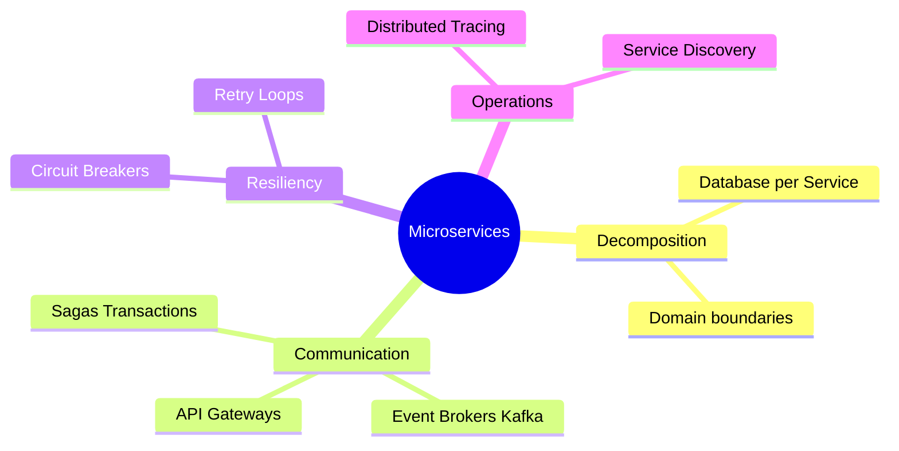

# Course Syllabus: Microservices Architecture

This course teaches how to design, decompose, integrate, and scale distributed microservices, moving away from monolithic systems into highly resilient architectures.

---

## 🗺️ Topic Map Overview

---

## 📁 Curriculum Modules

### Module 1: Decomposition & Boundaries
*   **Monolith to Microservices**: Strategies for decoupling legacy systems (Strangler Fig Pattern).
*   **Database-per-Service**: Ensuring data isolation between services to prevent shared-database coupling.
*   **Service Boundaries**: Using DDD Bounded Contexts to define microservice responsibilities.

### Module 2: Communication & Integration
*   **API Gateways**: Routing, load balancing, SSL termination, and rate-limiting at the boundary.
*   **Synchronous vs. Asynchronous**: Choosing HTTP/REST & gRPC vs. event brokers (Kafka, RabbitMQ).
*   **Saga Pattern**: Orchestrating distributed transactions across multiple services (Orchestration vs. Choreography) and managing compensating transactions.

### Module 3: Resiliency & Operations
*   **Fault Isolation**: Implementing Circuit Breakers, Bulkheads, and Rate-limiting policies.
*   **Service Discovery**: Managing dynamic network addresses (Consul, Eureka, Kubernetes DNS).
*   **Observability**: Setting up distributed tracing (OpenTelemetry, Jaeger), log consolidation (ELK stack), and metric monitoring (Prometheus/Grafana).
