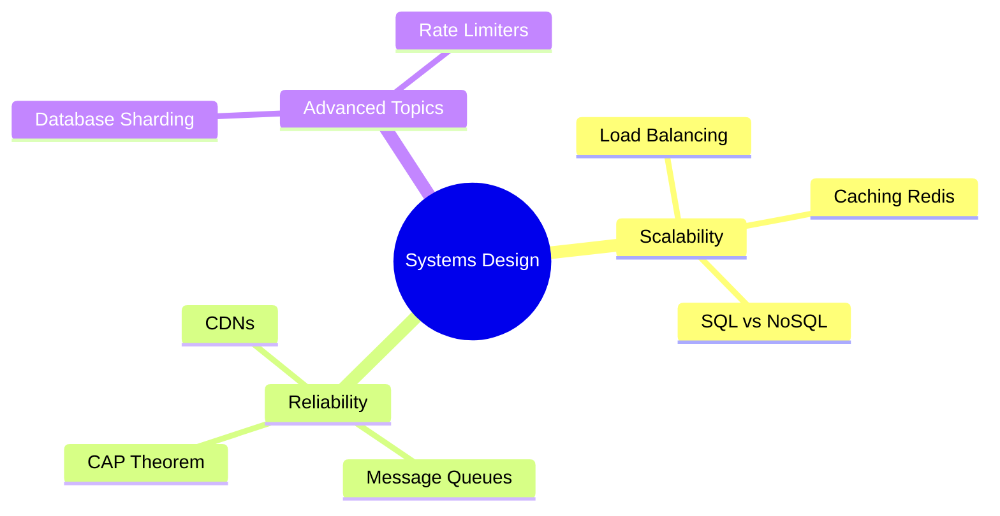

# Course Syllabus: Systems Design

This course teaches how to architect scalable, fault-tolerant, high-performance distributed systems, focusing on real-world engineering trade-offs.

---

## 🗺️ Topic Map Overview

---

## 📁 Curriculum Modules

### Module 1: Foundations of Scalability
*   **Vertical vs. Horizontal Scaling**: Understanding when to add resources to a single node vs. distributing load across a pool of nodes.
*   **Load Balancing & DNS**: Routing traffic across servers using algorithms like round-robin, least-connections, and IP-hash.
*   **Caching Strategies**: Implementing cache layers (CDN, Redis, Memcached), caching patterns (write-through, read-through, write-behind), and cache eviction policies (LRU, LFU).

### Module 2: Distributed Data & Consistency
*   **SQL vs. NoSQL**: Choosing the right database paradigm (Relational, Document, Key-Value, Columnar, Graph) for the query profile.
*   **Database Scaling**: Setting up Master-Slave replication, horizontal sharding, and consistent hashing.
*   **The CAP & PACELC Theorems**: Navigating the trade-offs between Consistency, Availability, Partition Tolerance, Latency, and Consistency in distributed data stores.

### Module 3: Reliability & System Communication
*   **Message Queues**: Decoupling services using asynchronous pub/sub messaging (Kafka, RabbitMQ).
*   **Content Delivery Networks (CDNs)**: Distributing static and dynamic media content geographically to minimize latency.
*   **Rate Limiting & Backpressure**: Designing rate limit algorithms (Leaky Bucket, Token Bucket, Sliding Window) to protect systems from denial-of-service bottlenecks.
