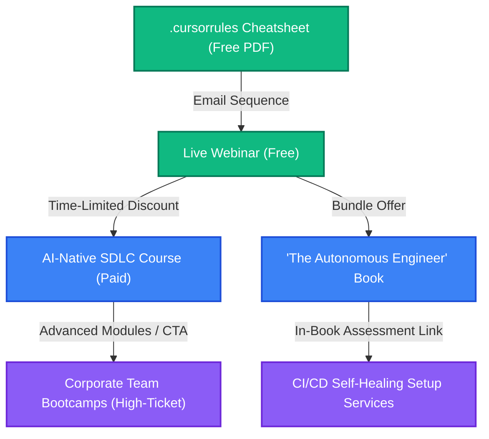

# Spin-Off Ecosystem & Funnel Plan: AI-Native SDLC

*   **Primary Project**: [The AI-Native SDLC Course](file:///Users/maxtomasello/git/own/software-engineering/courses/ai-native-sdlc/curriculum.md)
*   **Target Audience**: Software Engineers, Tech Leads, Engineering Managers, and CTOs.

This document outlines a connected monetization ecosystem that leverages the AI-Native SDLC curriculum to sell mid-tier products and high-ticket consulting/advisory services.

---

## 🗺️ Ecosystem Roadmap

---

## 🟢 Tier 1: Lead Magnets (Free Entry Points)

### 1. The Ultimate `.cursorrules` / `.windsurfrules` Template Pack
*   **Format**: PDF / GitHub Gist Repository.
*   **Value Proposition**: A collection of production-ready configuration templates that users can drop into their TypeScript, Python, and Go projects to immediately make AI coding agents 5x more reliable.
*   **Conversion Bridge**: Downloading the templates requires an email address. This triggers a 3-part educational email sequence culminating in an invitation to the live webinar.

### 2. Live Webinar: "The 3 Bottlenecks of Agile in the Era of Agentic Coding"
*   **Format**: 45-minute live presentations (hosted bi-weekly/monthly) + 15-minute Q&A.
*   **Content Outline**:
    - Why typing code is no longer the bottleneck.
    - How writing specifications (Specs) replaces writing Jira tickets.
    - Demonstrating a live agentic coding loop (e.g., watching an agent build a feature using compiler feedback).
*   **Conversion Bridge**: The final 10 minutes present a bundle: get **The AI-Native SDLC Course** + a pre-order of **The Autonomous Engineer Book** at a 30% discount.

---

## 🔵 Tier 2: Mid-Tier Products (Paid Content)

### 1. The AI-Native SDLC Course
*   **Format**: Video-on-demand modules (self-paced) + structured coding workspace challenges.
*   **Pricing Strategy**: ~$149 - $299 single purchase.
*   **Value Proposition**: Hands-on guides to setting up planning, development, and testing frameworks that scale with AI output velocity.

### 2. Book: "The Autonomous Engineer"
*   **Format**: eBook & Print-on-Demand (Amazon/Leanpub).
*   **Pricing Strategy**: ~$29 (eBook) / $39 (Paperback).
*   **Value Proposition**: A conceptual guide on career longevity, architectural patterns for AI, and lead-management of virtual software agent workforces.

---

## 🟣 Tier 3: High-Ticket Offers (High-Value Services)

### 1. Corporate Team Bootcamps
*   **Target**: CTOs and VPs of Engineering with teams of 10-100 developers.
*   **Format**: 2-day live interactive workshop (remote or on-site).
*   **Value Proposition**: Aligning the entire dev team on spec-driven engineering, custom lint pipelines for AI, and code review standards.
*   **Pricing**: $5,000 - $15,000 flat fee.

### 2. Custom Setup: CI/CD Self-Healing Test Pipelines
*   **Target**: Engineering organizations seeking to automate code fixes before pull requests reach human reviewers.
*   **Format**: 1-on-1 consultancy/implementation.
*   **Value Proposition**: We design and integrate custom agentic self-healing loops into their GitHub Actions or GitLab pipelines.
*   **Pricing**: $20,000+ custom implementation contract.

---

## 🔄 Detailed Conversion Bridges & Action Plan

### 🌉 Bridge A: Lead Pack ➔ Live Webinar
*   **Trigger**: User downloads the `.cursorrules` pack.
*   **Email 1 (Day 1)**: "Did it work? Here's how to customize the typescript rules block."
*   **Email 2 (Day 3)**: "Why writing code is dead: the paradigm shift."
*   **Email 3 (Day 5)**: "Register for my upcoming live webinar where I'll build a web app in 15 minutes live using agents."

### 🌉 Bridge B: Live Webinar ➔ Paid Course/Book
*   **Trigger**: Webinar attendance / replay view.
*   **Offer**: During the live demo, show the student exercises included in [Module 4 Guide](file:///Users/maxtomasello/git/own/software-engineering/courses/ai-native-sdlc/modules/module-4-development.md). 
*   **Call-to-Action**: "Go to `yoursite.com/bundle` to purchase the full course and get the book free for the next 48 hours."

### 🌉 Bridge C: Paid Products ➔ High-Ticket Services
*   **In-Course CTA**: At the end of [Module 6 (Multi-Agent Systems)](file:///Users/maxtomasello/git/own/software-engineering/courses/ai-native-sdlc/modules/module-6-future.md), add a lesson titled: *"Scaling this to a team of 50 developers."*
*   **Action**: Invite VPs and Managers to book a 30-minute "Team AI Readiness Assessment" call.
*   **Outcome**: Convert the audit call into a Corporate Team Bootcamp or a custom pipeline contract.
