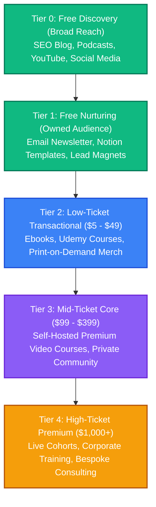
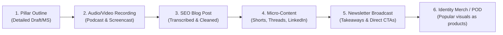

# Universal Content Workflow and Revenue Engine

This document defines a repeatable, topic-agnostic strategy for turning knowledge and content into a sustainable revenue generator. This engine can be applied to any subject (such as [Software Engineering](file:///Users/maxtomasello/git/own/content-creation/software-engineering/README.md)) to build an audience, capture emails, and monetize across multiple tiers.

---

## 👥 Two Strategic Tracks: Authority vs. Curator

Depending on your level of personal expertise in a topic, the content persona, marketing approach, and monetization engine will branch into one of two tracks:

### Track A: The Authority (Expert) Track
*   **Role/Persona**: The Expert Guide & Solution Architect.
*   **Narrative**: *"I have solved this problem in production or real life, and I will show you how to do the same."*
*   **Monetization Profile**: High-margin products, starter kits/boilerplate code, deep premium courses, live cohort-based workshops, and high-ticket consulting/corporate training.
*   **Target Topics**: [Software Engineering](file:///Users/maxtomasello/git/own/content-creation/software-engineering/README.md), AI-Native SDLC, Algorithmic Trading, Negotiation.

### Track B: The Curator (Learner) Track
*   **Role/Persona**: The Active Learner, Synthesizer, & Facilitator.
*   **Narrative**: *"I am fascinated by this topic and studying it deeply. Here are the best summaries, mental models, and curated insights I have discovered."*
*   **Monetization Profile**: Newsletter sponsorships, paid subscription newsletters, Ebooks (curations/summaries), book/software affiliate commissions, facilitated reading/discussion cohorts (peer-to-peer accountability), and culture-oriented Print-on-Demand (POD) merchandise.
*   **Target Topics**: The Bible & its psychological meaning, Socioeconomic History, Argumentation Theory, Mathematics, Physics, Psychology, Languages, Personal Development.

---

## 📈 The Revenue Engine (The Value Ladder)

Rather than relying on a single channel, this strategy uses a **Value Ladder**. Each tier is designed to build trust and move readers from free discovery to low-ticket transactions, and finally to high-margin premium offerings.



### Tier 0: Free Discovery (Top of Funnel - ToFu)
*   **Channels**: SEO-optimized Blog (with ads), Podcasts (audio-only), Short-form video (YouTube Shorts, LinkedIn, Twitter/X).
*   **Objective**: Capture attention from organic search and social media algorithms.
*   **Primary Metric**: Impressions, search clicks, and unique visitors.
*   **Secondary Monetization**: Ad networks (Mediavine, Raptive, AdSense) and affiliate links. *Note: Display ads are not the goal; they are a secondary layer to monetize long-tail traffic.*

### Tier 1: Free Nurturing (Middle of Funnel - MoFu)
*   **Channels**: Email Newsletter (beehiiv, ConvertKit) + Lead Magnets (Notion databases, checklists, PDF summaries, or short courses like [The AI-Native Developer Crash Course](file:///Users/maxtomasello/git/own/content-creation/software-engineering/courses/ai-native-sdlc/spinoff_crash_course.md)).
*   **Objective**: Convert anonymous Tier 0 visitors into an "owned" audience. Email is the highest-converting marketing channel because it is algorithm-proof.
*   **Primary Metric**: Newsletter subscription rate and email open rate.

### Tier 2: Low-Ticket Transactional (Entry-Level Paid - MoFu)
*   **Products**:
    *   **Ebooks**: Self-published guides sold on Gumroad or Amazon Kindle. Low-friction barrier to buy ($9 - $29).
    *   **Udemy Courses**: Mass-market video courses. Udemy controls the traffic and heavily discounts, but it acts as a massive customer acquisition engine for students who wouldn't otherwise find you.
    *   **Print-on-Demand (POD) Merch**: Niche t-shirts, mugs, or posters featuring technical architectural diagrams, frameworks, or community jokes (using services like Printful or Printify integrated with Shopify/Gumroad).
*   **Objective**: Qualify buyers. A user who pays $9 is 10x more likely to buy a $300 course than a free newsletter subscriber.
*   **Primary Metric**: Average Order Value (AOV) and conversion rate.

### Tier 3: Mid-Ticket Core (Self-Hosted Premium - BoFu)
*   **Products**: High-quality, deep-dive video courses hosted on your own platform (Teachable, Podia, Kajabi) and private community access (Discord, Circle). Priced between $99 - $399.
*   **Objective**: Deliver real, comprehensive transformations. You capture 100% of the margins and build a core student base.
*   **Primary Metric**: Monthly Recurring Revenue (MRR) or launch revenue.

### Tier 4: High-Ticket Premium (Enterprise & High Leverage - BoFu)
*   **Products**: Live Cohort-Based Workshops, In-person Corporate Training (like [In-Person Workshop Guide](file:///Users/maxtomasello/git/own/content-creation/software-engineering/courses/ai-native-sdlc/in_person_workshop.md)), and bespoke Consulting.
*   **Objective**: Maximize revenue per customer by providing personalized access, customized implementations, or enterprise-wide licenses.
*   **Primary Metric**: Client lifetime value (LTV).

---

## 🔄 The Repeatable Content Workflow (The Pillar Repurposing Loop)

To prevent content creator burnout, we use the **Create Once, Distribute Multi-Format (CODM)** workflow. Every piece of content you release is sliced and repurposed from one master "Pillar Outline."



### The Weekly Cycle Workflow:
1.  **Phase 1: Research & Outline (The Source of Truth)**
    *   Pick a sub-topic (e.g., *Spec-First Engineering*).
    *   Write a comprehensive markdown document with clear explanations, architectural diagrams (Mermaid), and code snippets.
    *   *Time commitment*: 3 hours.
2.  **Phase 2: Recording (The Human Presence)**
    *   Record yourself presenting the Outline.
        *   **Video**: Capture your screen (screencast) or record yourself speaking.
        *   **Audio**: Extract the audio track.
    *   *Result*: 1 YouTube Video + 1 Podcast Episode.
    *   *Time commitment*: 1 hour.
3.  **Phase 3: Blog Publication (The Organic Trap)**
    *   Clean up the script/outline into a readable article. Inject keywords and proper SEO formatting.
    *   Embed the YouTube video at the top of the post to boost page dwell time.
    *   Add a prominent opt-in box: *"Get the Cheat Sheet & exercises for this topic."*
    *   *Time commitment*: 1.5 hours.
4.  **Phase 4: Social Atomization (The Net)**
    *   Cut the video into 2-3 vertical clips (Reels, TikToks, Shorts) highlighting key insights.
    *   Summarize the code snippet or framework into 1 LinkedIn post and a Twitter/X thread.
    *   *Time commitment*: 1 hour.
5.  **Phase 5: Email Broadcast (The Conversion Engine)**
    *   Send a personalized email containing the key takeaways of the topic to the newsletter list.
    *   At the bottom, include a direct link to the blog post, video, podcast, and a soft pitch for the paid Ebook or Premium Course.
    *   *Time commitment*: 0.5 hours.
6.  **Phase 6: Merch Capture (The Culture Loop)**
    *   If a diagram or slogan from the lesson gets high engagement on socials (e.g., *"A Spec is worth 1000 prompts"*), convert the visual into a print design and upload it to your POD store. Link to it in the next newsletter.
    *   *Time commitment*: 0.5 hours (on demand).

---

## 🔗 Channel Interlinking & Conversion Paths

To make the engine self-sustaining, each channel must actively drive users to the next level of the Value Ladder:

| From Channel | To Channel | The Mechanism (CTA) |
| :--- | :--- | :--- |
| **SEO Blog** | Newsletter / Lead Magnet | "Get the PDF cheat sheet and source code for this architecture directly in your inbox." |
| **Podcast / YouTube** | SEO Blog | "Read the full code walkthrough and copy-paste the scripts at the link in the description." |
| **Podcast / YouTube** | Newsletter | "Sign up for the newsletter to receive weekly summaries and early access to courses." |
| **Newsletter (Free)** | Ebook / Udemy (Low) | "I've compiled all 10 topics into a single, offline-ready Ebook with 3 bonus chapters. Get it for $19 this week." |
| **Udemy Course** | Premium Course (Mid) | "This is a basic introduction. For the complete, self-healing pipeline framework and group projects, check out my Premium Masterclass." |
| **Ebook / Gumroad** | Premium Course (Mid) | Insert QR codes / links at the end of each chapter linking to video deep-dives in the premium course. |
| **Premium Course** | Corporate / Consulting (High) | A final module or email follow-up: "Need this implemented for your enterprise engineering team? Apply for a 2-day on-site corporate workshop." |
| **All Channels** | POD Merch | Feature custom t-shirts/mugs visually in your YouTube videos and newsletter footers. |

---

## 🎯 Topic Setup Template

When starting a new topic folder in the workspace, structure it like this to support the engine:

```text
📁 <topic-name>/
├── 📄 README.md                 # Topic roadmap and target audience definition
├── 📁 blog/                     # Articles and SEO keyword research
├── 📁 podcast/                  # Podcast outlines and audio transcripts
├── 📁 courses/                  # Outline files for Udemy & Premium versions
├── 📁 books/                    # Draft manuscripts and ebook outlines
├── 📁 assets/                   # Images, diagrams, and print-on-demand designs
└── 📁 templates-and-code/       # Source code and templates sold/given as lead magnets
```
